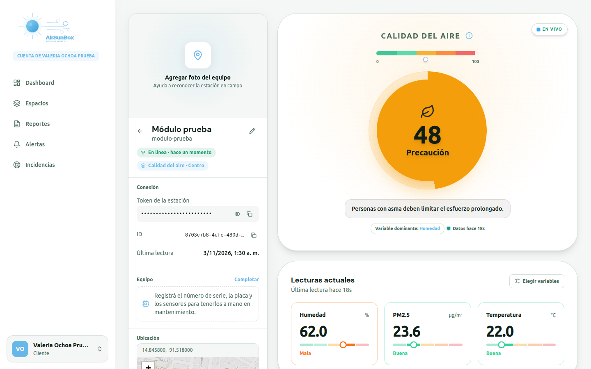
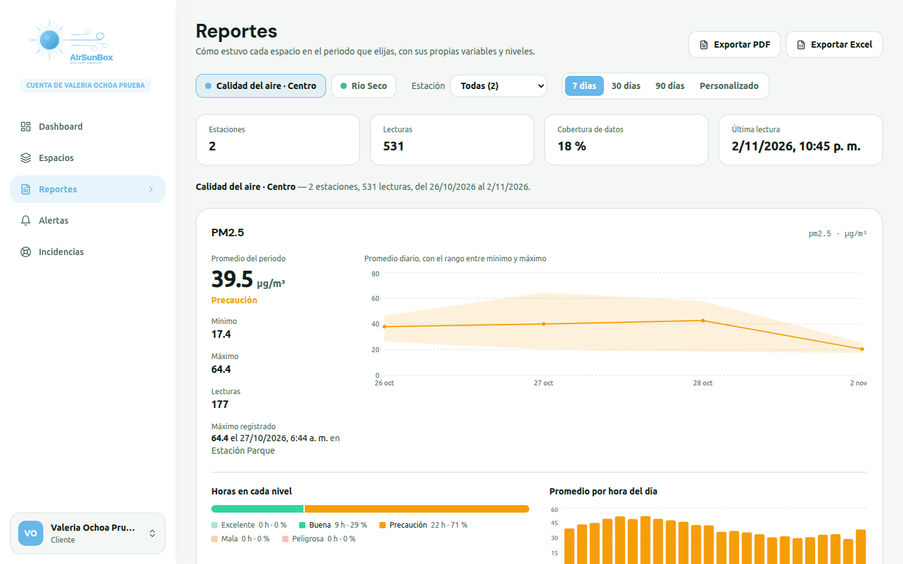
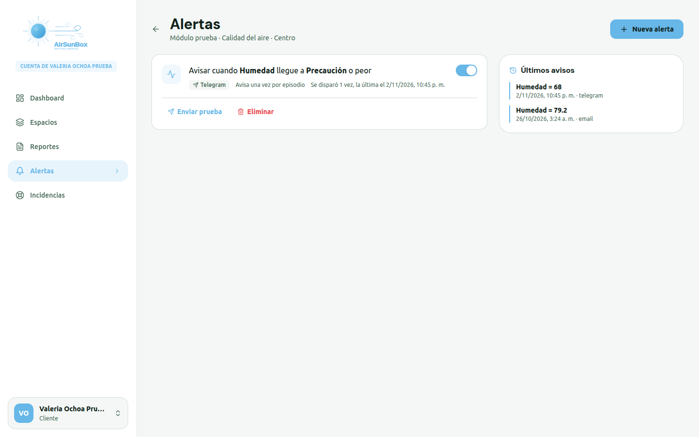
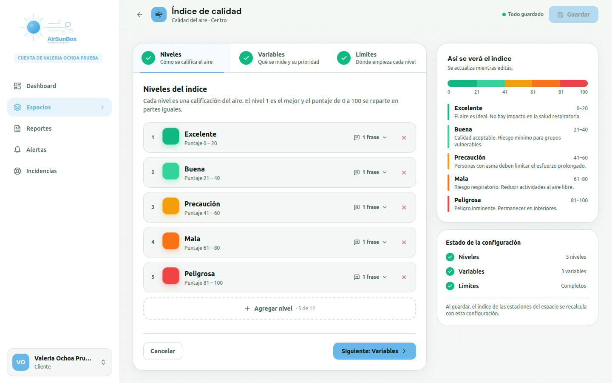
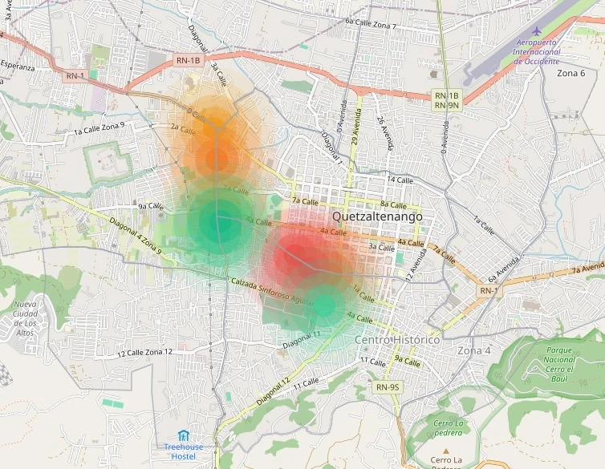
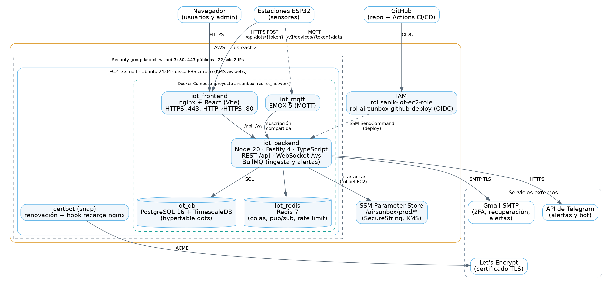
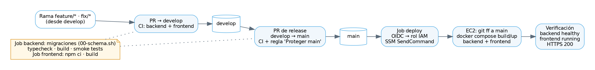

<div align="center">


# AirSunBox

**Plataforma IoT de monitoreo de calidad del aire para Guatemala**

Estaciones ESP32 miden PM2.5, CO₂, temperatura, humedad y otros gases. La
plataforma recibe sus lecturas, calcula un índice de calidad del aire en tiempo
real, avisa cuando se superan los umbrales y lo publica en un mapa abierto para
la ciudadanía.

[](https://github.com/JCR2005/AirSunBox/actions/workflows/ci.yml)
[](LICENSE)


**Demo en video: LINK_DEL_VIDEO**

</div>



## El problema

En Quetzaltenango, como en la mayoría de ciudades de Guatemala, no hay datos
públicos y continuos sobre la calidad del aire. Las instituciones que quieren
medirla (municipalidades, universidades, hospitales, empresas) terminan con
sensores aislados, hojas de cálculo y ninguna forma de avisar a tiempo cuando
el aire se vuelve peligroso.

AirSunBox conecta esas estaciones a una sola plataforma: cada organización
administra las suyas, define qué es aire «bueno» o «malo» para su contexto y
recibe avisos. Los datos agregados se publican en un mapa abierto para que
cualquier persona sepa cómo está el aire de su zona.

## Funcionalidades

**Para las organizaciones (clientes)**

- **Estaciones en tiempo real:** lecturas por HTTP o MQTT, estado en línea,
  índice de calidad del aire con recomendación de salud y tarjetas por
  variable que se actualizan por WebSocket.
- **Índice de calidad configurable:** cada espacio define sus niveles, sus
  variables con prioridad y los límites de cada nivel, con vista previa en vivo.
- **Alertas:** reglas por índice o por variable, con aviso por correo,
  Telegram o webhook, plantillas de mensaje y envío de prueba.
- **Reportes exportables a PDF y Excel:** islas de calor, riesgo respiratorio,
  historial por estación y reporte completo de un espacio (horas en cada
  nivel, serie diaria, perfil por hora del día, cobertura de datos, alertas e
  incidencias).
- **Conexión guiada del equipo:** dirección de envío, formato del JSON con la
  clave de cada variable y sketch listo para ESP32/ESP8266.
- **Dos modelos de cliente:** organizaciones *dependientes*, gestionadas por el
  equipo de AirSunBox, e *independientes*, que crean sus propios espacios,
  variables y estaciones.
- Solicitudes de estaciones, reporte de incidencias y ficha técnica con foto
  de cada equipo.

**Para el equipo de AirSunBox**

- Panel de control, gestión de clientes, catálogo global de variables,
  atención de solicitudes e incidencias y gestión del equipo por roles
  (superadministrador, administrador y trabajador).

**Para la ciudadanía**

- **Mapa ambiental público** por zonas de Quetzaltenango, con halos de color
  según la calidad del aire, búsqueda por lugar y recomendaciones, sin
  necesidad de una cuenta.

## Capturas

| Reporte de un espacio | Alertas |
|---|---|
|  |  |
| **Configuración del índice de calidad** | **Mapa público** |
|  |  |

## Arquitectura



Un **monolito modular**: un solo backend con módulos por dominio (identidad,
organizaciones y espacios, estaciones, ingesta, telemetría, alertas, reportes,
soporte y datos públicos), desplegado con Docker Compose en AWS.

El recorrido de una lectura:

1. La estación envía un JSON por `HTTPS POST /api/dots/<token>` o por MQTT.
2. El backend valida el token y traduce la clave que envía la estación a la
   variable interna.
3. La lectura entra a una cola (BullMQ sobre Redis) y un worker la guarda en
   una *hypertable* comprimida de TimescaleDB.
4. Se recalcula el índice de calidad y se publica por Redis pub/sub a los
   paneles conectados por WebSocket.
5. El motor de alertas evalúa las reglas de la estación y envía los avisos.

La evolución propuesta hacia **microservicios sobre servicios gestionados de
AWS** (IoT Core, SQS, EventBridge, ECS Fargate, Aurora) está en
[Escalabilidad futura](docs/escalabilidad.md).

## Stack

| Capa | Tecnologías |
|---|---|
| Backend | Node.js 20, Fastify 4, TypeScript, TypeBox, BullMQ, MQTT.js, Nodemailer, Swagger |
| Datos | PostgreSQL 16 + TimescaleDB (series de tiempo comprimidas), Redis 7 |
| Mensajería IoT | EMQX 5 (MQTT y MQTT sobre TLS) |
| Frontend | React 18, Vite, Tailwind CSS, Zustand, Recharts, Leaflet, jsPDF, SheetJS |
| Hardware | ESP32 / ESP8266 con sensores de partículas, gases, temperatura y humedad |
| Infraestructura | AWS EC2, SSM Parameter Store, KMS, IAM con OIDC, Terraform, Docker Compose, nginx, Let's Encrypt |
| CI/CD | GitHub Actions |
| Observabilidad | Logs estructurados (pino), métricas Prometheus (`/metrics`) |

## Seguridad

- **Sin secretos en el repositorio.** En producción, `JWT_SECRET`,
  `DB_PASSWORD` y `SMTP_PASS` viven cifrados en AWS SSM Parameter Store
  (SecureString con KMS) y el backend los lee al arrancar con el rol IAM de
  la instancia. Los scripts del proceso están en
  [`infra/seguridad`](infra/seguridad/README.md).
- **Cifrado en tránsito y en reposo:** HTTPS con TLS 1.3 y HSTS, redirección
  301 desde HTTP y disco EBS cifrado con KMS.
- **Autenticación:** contraseñas con bcrypt, JWT con revocación en el servidor
  (cerrar sesión o cambiar la contraseña invalida los tokens anteriores),
  verificación en dos pasos por correo, recuperación de contraseña con tokens
  de un solo uso y límite de intentos.
- **Aislamiento entre organizaciones:** cada consulta se filtra por la
  organización de la sesión; los webhooks se validan contra direcciones
  internas (SSRF).
- **Superficie mínima:** el grupo de seguridad solo abre 80 y 443 al público
  (SSH, a dos IPs); la base, Redis, la API y el broker MQTT solo se alcanzan
  desde la red interna.

## Flujo de trabajo y despliegue



- **GitFlow:** ramas `feature/*`, `fix/*` y `hotfix/*` → PR a `develop` →
  PR de *release* a `main`. Más de 60 PRs integrados.
- **Integración continua:** en cada PR, el job `backend` levanta TimescaleDB y
  Redis, aplica todas las migraciones sobre una base vacía, verifica tipos y
  compila; después corre tres grupos de pruebas con `node:test`:
  - **unitarias** del cálculo del índice de calidad del aire: niveles y sus
    límites, ponderación por prioridad, variables sin datos, espacios sin
    configuración y variable dominante;
  - **de humo** contra la API en marcha;
  - **de seguridad** contra la API en marcha: un token deja de valer al
    cerrar sesión o al cambiar la contraseña, y una organización no puede
    leer, listar, editar ni borrar espacios, estaciones ni reportes de otra.

  El job `frontend` compila la aplicación. La rama `main` está protegida:
  solo acepta PRs con ambos checks en verde.
- **Despliegue continuo:** al integrar en `main`, el job `deploy` se
  autentica en AWS por OIDC (sin claves guardadas), ejecuta el despliegue en
  la instancia con SSM Run Command y verifica que la API y la web respondan.
- **Infraestructura como código:** VPC, subred, grupo de seguridad e
  instancia descritos con [Terraform](terraform/).
- **Migraciones:** 23 scripts SQL idempotentes (del esquema inicial a la
  `v24`), aplicados en orden por `database/initdb/00-schema.sh`.

## Documentación

| Documento | Contenido | PDF |
|---|---|---|
| [Manual técnico](docs/manual-tecnico.md) | Arquitectura, modelo de datos, API, seguridad, CI/CD y trazabilidad de requisitos | [PDF](docs/entregables/fase-3/Manual_Tecnico_AirSunBox.pdf) |
| [Manual de usuario](docs/manual-usuario.md) | Guía por rol: clientes, equipo interno y ciudadanía | [PDF](docs/entregables/fase-3/Manual_Usuario_AirSunBox.pdf) |
| [Runbook](docs/runbook.md) | Despliegue, rollback, monitoreo y atención de incidentes | [PDF](docs/entregables/fase-3/Runbook_AirSunBox.pdf) |
| [Escalabilidad futura](docs/escalabilidad.md) | Procesos BPMN, migraciones planificadas y evolución a microservicios | [PDF](docs/entregables/fase-3/Escalabilidad_Futura_AirSunBox.pdf) |
| [Casos de uso](docs/casos-de-uso.txt) | Casos de uso extendidos por rol | — |

### Entregas por fase

El proyecto se desarrolló en tres fases. Todas las entregas están en
[`docs/entregables`](docs/entregables):

| Fase | Entregas |
|---|---|
| **Fase 1: análisis y diseño** | [Fundamentos](docs/entregables/fase-1/01-fundamentos.pdf) · [Descripción del proyecto y la empresa](docs/entregables/fase-1/02-descripcion-del-proyecto-y-la-empresa.pdf) · [Problema, objetivos y alcance](docs/entregables/fase-1/03-definicion-del-problema-objetivos-y-alcance.pdf) · [Requisitos funcionales y no funcionales](docs/entregables/fase-1/04-requisitos-funcionales-y-no-funcionales.pdf) · [Análisis económico](docs/entregables/fase-1/05-analisis-economico-y-de-alcance.pdf) · [Riesgos](docs/entregables/fase-1/06-identificacion-y-analisis-de-riesgos.pdf) · [Procesos de negocio](docs/entregables/fase-1/07-procesos-de-negocio.pdf) · [Arquitecturas iniciales](docs/entregables/fase-1/08-diseno-de-arquitecturas-iniciales.pdf) · [Diseño visual (mockups)](docs/entregables/fase-1/09-propuesta-de-diseno-visual-mockups.pdf) · [GitFlow](docs/entregables/fase-1/10-definicion-de-gitflow.pdf) · [Diagramas BPMN, de arquitectura y mockups](docs/entregables/fase-1/diagramas) |
| **Fase 2: construcción** | [Documentación técnica](docs/entregables/fase-2/documentacion-tecnica.pdf) · [Documentación de usuario](docs/entregables/fase-2/documentacion-de-usuario.pdf) · [Planilla de casos de uso](docs/entregables/fase-2/planilla-de-casos-de-uso.pdf) · [Fuentes de los diagramas](docs/entregables/fase-2/fuentes) |
| **Fase 3: producción y operación** | Los cuatro documentos de la tabla anterior |

## Estructura del repositorio

```
AirSunBox/
├── plataforma-iot-airsunbox/   # Código: backend, frontend, migraciones y docker-compose
├── docs/                       # Manuales, runbook, diagramas y capturas
├── infra/seguridad/            # Scripts de secretos en SSM y cifrado del disco
├── terraform/                  # Infraestructura de AWS como código
├── geojson/                   # Polígono de referencia de la Zona 3 de Quetzaltenango
└── .github/workflows/ci.yml    # CI y despliegue continuo
```

## Ejecutarlo localmente

La guía completa (configuración, servicios, primer usuario y envío de
lecturas de prueba) está en
[`plataforma-iot-airsunbox/README.md`](plataforma-iot-airsunbox/README.md).
En resumen:

```bash
cd plataforma-iot-airsunbox
cp backend/.env.example backend/.env    # completar DB_PASSWORD y JWT_SECRET
docker compose up -d timescaledb redis emqx backend
cd frontend && npm install && npm run dev
```

## Estado

Proyecto desarrollado para el curso Seminario de Sistemas 1 de la Universidad
de San Carlos de Guatemala, Centro Universitario de Occidente (CUNOC), en tres
fases. Estuvo en producción en AWS con 10 estaciones y más de 560 000
lecturas. Al cerrar la fase 3, la instancia se detuvo para no consumir
créditos; el entorno completo se puede levantar localmente con Docker.

## Equipo

| | Rol |
|---|---|
| **Juan Carlos Rodríguez López** ([@JCR2005](https://github.com/JCR2005)) | Líder del proyecto; desarrollo del backend, el frontend y la seguridad de producción |
| **Dany de León Santizo** ([@DNLS89](https://github.com/DNLS89)) | Infraestructura en AWS, Terraform y despliegue continuo |

## Licencia

[MIT](LICENSE) © 2026 Juan Carlos Rodríguez López
