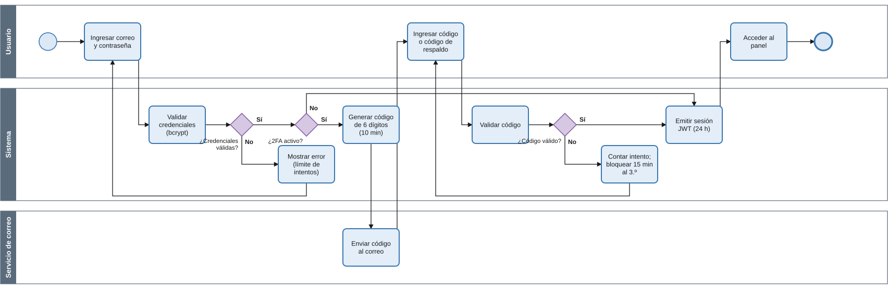
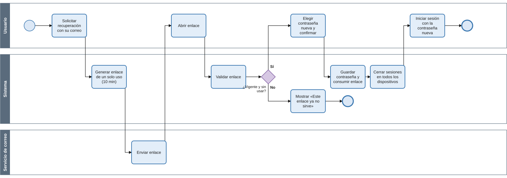
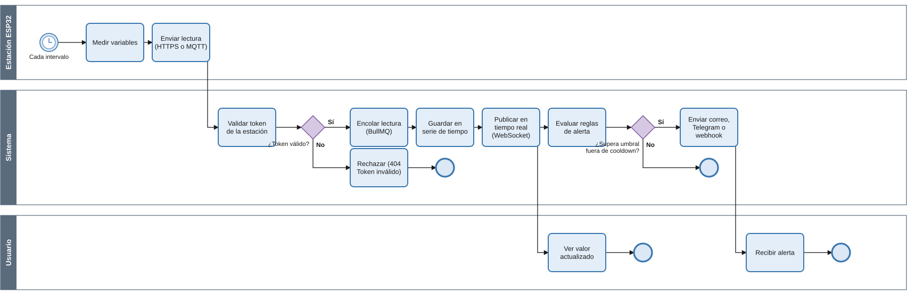
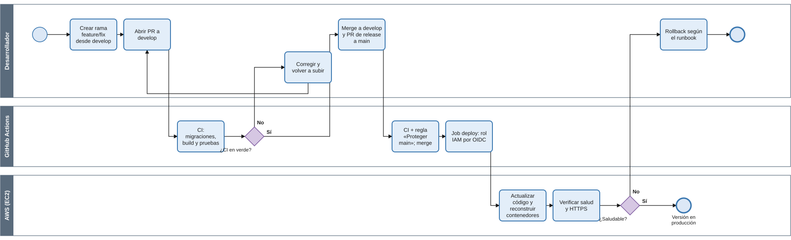
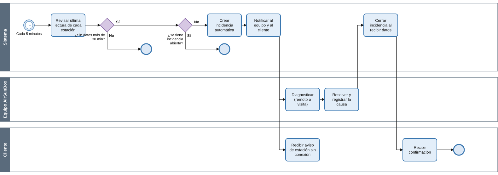
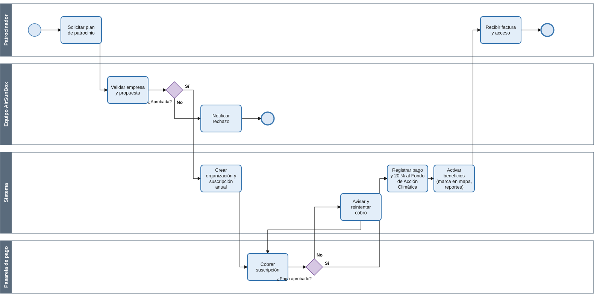
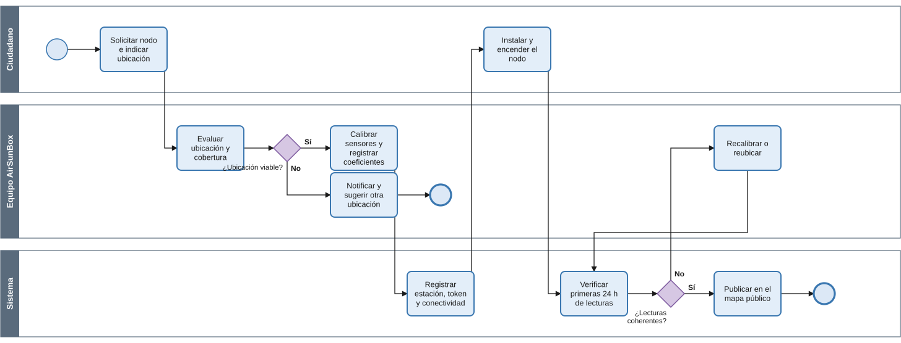
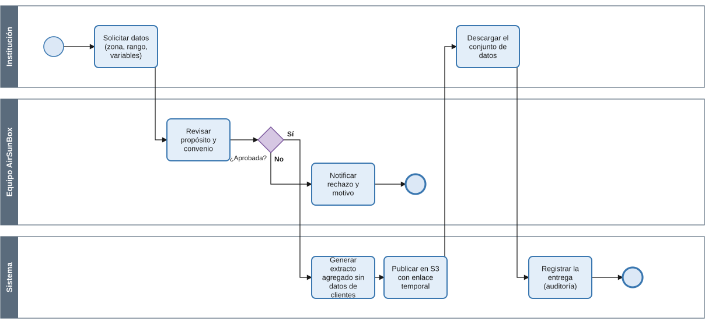
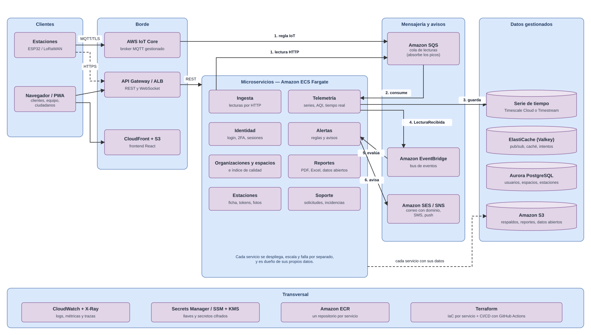

# Introducción

Este documento prepara a AirSunBox para crecer más allá de la red actual del
CUNOC: de unas decenas de estaciones institucionales a una red ciudadana y a
un modelo de patrocinio corporativo. Reúne tres insumos para ese crecimiento:

- **Procesos identificados y diagramados en BPMN.** Continúa la numeración
  del documento *Procesos de negocio* (PRO-01 a PRO-14):
  - PRO-15 a PRO-18 son procesos que se incorporaron en las fases 2 y 3 y ya
    están en producción;
  - PRO-19 a PRO-22 son procesos nuevos que la plataforma necesitará para
    escalar.
- **Migraciones necesarias** para que el modelo de datos evolucione sin
  perder información ni detener el servicio.
- **Tecnologías nuevas**: la evolución del monolito modular actual hacia una
  **arquitectura de microservicios** sobre servicios gestionados de AWS
  (AWS IoT Core para MQTT, Amazon ElastiCache para Redis, Amazon SQS y
  EventBridge para la mensajería, Amazon ECS Fargate para los servicios), con
  la justificación de cada tecnología y el orden en que conviene adoptarla.

## Punto de partida

| Aspecto | Situación actual (fase 3) |
|---|---|
| Despliegue | 1 instancia EC2 `t3.small` con Docker Compose (nginx, backend, TimescaleDB, Redis, EMQX) |
| Datos | 10 estaciones, más de 560 000 lecturas en una hypertable comprimida |
| Esquema | 23 scripts SQL idempotentes (hasta la `v24`), aplicados en orden por `00-schema.sh` |
| Arquitectura | **Monolito modular**: un solo backend (Fastify) con módulos internos —identidad, organizaciones y espacios, estaciones, ingesta, telemetría, alertas, reportes, soporte y datos públicos— que comparten proceso y base de datos |
| Operación | CI/CD con GitHub Actions; secretos en AWS SSM; disco cifrado |
| Limitaciones conocidas | Todo escala junto (un pico de ingesta afecta a los reportes y al panel), un solo servidor, broker MQTT y Redis administrados a mano, IP pública sin Elastic IP, respaldos manuales |

# 1. Procesos identificados y diagramados (BPMN)

## 1.1 Inventario de procesos

| Código | Proceso | Estado | Requisitos relacionados |
|---|---|---|---|
| PRO-15 | Inicio de sesión con verificación en dos pasos | En producción | RF01, RF03, RNF01 |
| PRO-16 | Recuperación de contraseña con cierre de sesiones | En producción | RF02, RNF01 |
| PRO-17 | Ingesta y procesamiento de lecturas | En producción | RF25–RF27, RF30–RF32, RNF07 |
| PRO-18 | Despliegue continuo de una nueva versión | En producción | RNF06 |
| PRO-19 | Detección automática de estación sin conexión | A futuro | RF33–RF35, RF39 |
| PRO-20 | Suscripción de organización patrocinadora | A futuro | Modelo de negocio (RSE) |
| PRO-21 | Alta de nodo ciudadano autónomo | A futuro | Red ciudadana, RF49 |
| PRO-22 | Entrega de datos abiertos para investigación | A futuro | Aliados (MSPAS, universidades) |

## PRO-15 — Inicio de sesión con verificación en dos pasos

#### Objetivo

Permitir el acceso a la plataforma solo a quien conoce la contraseña y
controla el correo de la cuenta, cuando la cuenta o su organización exigen
2FA.

#### Alcance

Todos los usuarios (equipo interno y clientes). El segundo paso aplica si el
usuario activó 2FA o si la política de su organización lo exige.

#### Responsables

- **Usuario:** ingresa sus credenciales y el código.
- **Sistema:** valida, genera el código, limita intentos y emite la sesión.
- **Servicio de correo:** entrega el código.

#### Procedimiento

1. El usuario ingresa correo y contraseña.
2. El sistema valida las credenciales. Si fallan, muestra el error; el límite
   de peticiones por IP frena los intentos repetidos.
3. Si la cuenta no tiene 2FA, el sistema emite la sesión (JWT de 24 h).
4. Si tiene 2FA, el sistema genera un código de 6 dígitos válido por 10
   minutos y el servicio de correo lo envía.
5. El usuario ingresa el código o un código de respaldo.
6. Si el código es inválido, se cuenta el intento; al tercero la cuenta se
   bloquea 15 minutos.
7. Con el código válido el sistema emite la sesión y el usuario entra al
   panel.



## PRO-16 — Recuperación de contraseña con cierre de sesiones

#### Objetivo

Recuperar el acceso de forma segura y cerrar cualquier sesión abierta con la
contraseña anterior.

#### Alcance

Cualquier usuario que olvidó su contraseña. Un restablecimiento hecho por el
equipo interno (PRO-10) también cierra las sesiones y anula los enlaces
pendientes.

#### Responsables

- **Usuario:** solicita el enlace y elige la contraseña nueva.
- **Sistema:** genera y valida el enlace, guarda la contraseña y revoca las
  sesiones.
- **Servicio de correo:** entrega el enlace.

#### Procedimiento

1. El usuario solicita la recuperación con su correo. La respuesta es la
   misma exista o no la cuenta.
2. El sistema genera un enlace de un solo uso (token aleatorio de 256 bits,
   guardado como hash) válido por 10 minutos, y el correo lo envía. Pedir un
   enlace nuevo anula el anterior.
3. Al abrir el enlace, el sistema verifica que esté vigente y sin usar; si no,
   muestra «Este enlace ya no sirve».
4. El usuario elige y confirma la contraseña nueva.
5. El sistema guarda la contraseña y consume el enlace en la misma
   operación, de modo que dos usos simultáneos no pasan.
6. El sistema cierra la sesión en todos los dispositivos y el usuario inicia
   sesión con la contraseña nueva.



## PRO-17 — Ingesta y procesamiento de lecturas

#### Objetivo

Recibir las lecturas de las estaciones sin perder datos, mostrarlas en tiempo
real y disparar las alertas configuradas.

#### Alcance

Todas las estaciones, por HTTPS (`POST /api/dots/{token}`) o MQTT.

#### Responsables

- **Estación ESP32:** mide y envía.
- **Sistema:** valida, encola, guarda, publica y evalúa alertas.
- **Usuario:** ve los valores y recibe las alertas.

#### Procedimiento

1. En cada intervalo la estación mide sus variables y envía la lectura.
2. El sistema identifica la estación por su token. Si no existe, responde
   `404` y descarta la lectura.
3. La lectura entra a una cola persistente (BullMQ sobre Redis). Así la API
   responde rápido y un pico de envíos no se pierde.
4. El worker guarda la lectura en la serie de tiempo y actualiza la última
   conexión de la estación.
5. El sistema publica el valor por WebSocket y el panel se actualiza sin
   recargar.
6. El sistema evalúa las reglas de alerta. Si se supera un umbral fuera del
   periodo de espera (*cooldown*), notifica por correo, Telegram o webhook y
   registra el envío.



## PRO-18 — Despliegue continuo de una nueva versión

#### Objetivo

Llevar un cambio a producción de forma automática, probada y trazable.

#### Alcance

Todo cambio de código del repositorio.

#### Responsables

- **Desarrollador:** trabaja en una rama, abre los PR y hace los merge.
- **GitHub Actions:** ejecuta el CI y el job de despliegue.
- **AWS (EC2):** recibe y levanta la versión.

#### Procedimiento

1. El desarrollador crea una rama `feature/` o `fix/` desde `develop` y abre
   un PR.
2. El CI aplica todas las migraciones sobre una base vacía, compila y ejecuta
   las pruebas. Si falla, el desarrollador corrige y vuelve a subir.
3. Con el CI en verde, se hace merge a `develop` y se abre el PR de *release*
   a `main`, protegido por la regla «Proteger main».
4. Al hacer merge a `main`, el job de despliegue asume un rol IAM por OIDC (sin
   claves) y, mediante SSM, actualiza el código y reconstruye los
   contenedores.
5. Si la verificación de salud y HTTPS falla, el desarrollador aplica el
   rollback documentado en el runbook.



## PRO-19 — Detección automática de estación sin conexión

#### Objetivo

Detectar sin intervención humana las estaciones que dejaron de enviar datos,
y avisar al equipo y al cliente. Hoy las incidencias solo se registran a mano.

#### Alcance

Todas las estaciones activas.

#### Responsables

- **Sistema:** revisa, crea y cierra la incidencia, y notifica.
- **Equipo AirSunBox:** diagnostica y resuelve.
- **Cliente:** recibe los avisos.

#### Procedimiento

1. Cada 5 minutos el sistema revisa la última lectura de cada estación.
2. Si una estación lleva más de 30 minutos sin datos y no tiene una
   incidencia abierta, el sistema crea una incidencia automática.
3. El sistema notifica al equipo y al cliente.
4. El equipo diagnostica (de forma remota o con visita) y registra la causa.
5. Cuando la estación vuelve a enviar datos, el sistema cierra la incidencia
   y confirma al cliente.



## PRO-20 — Suscripción de organización patrocinadora

#### Objetivo

Incorporar empresas patrocinadoras con suscripción anual, el modelo de
sostenibilidad definido en el análisis de negocio. El 20 % de cada pago va al
Fondo de Acción Climática.

#### Alcance

Empresas con presupuesto de Responsabilidad Social Empresarial (RSE).

#### Responsables

- **Patrocinador:** solicita el plan y paga.
- **Equipo AirSunBox:** valida la empresa.
- **Sistema:** crea la suscripción, registra el pago y activa los beneficios.
- **Pasarela de pago:** procesa el cobro.

#### Procedimiento

1. La empresa solicita un plan de patrocinio.
2. El equipo valida la empresa y la propuesta; si la rechaza, se le notifica.
3. El sistema crea la organización y una suscripción anual.
4. La pasarela cobra la suscripción. Si el pago falla, el sistema avisa y
   reintenta.
5. Con el pago aprobado, el sistema lo registra y separa el 20 % para el Fondo
   de Acción Climática.
6. El sistema activa los beneficios del patrocinador (marca en el mapa
   público, reportes) y la empresa recibe la factura y el acceso.



## PRO-21 — Alta de nodo ciudadano autónomo

#### Objetivo

Sumar nodos instalados por ciudadanos, la red ampliada prevista en la
descripción del proyecto, con calidad de datos controlada.

#### Alcance

Nodos fuera de la red institucional, con conectividad WiFi o LoRaWAN.

#### Responsables

- **Ciudadano:** solicita, instala y mantiene el nodo.
- **Equipo AirSunBox:** evalúa la ubicación y calibra los sensores.
- **Sistema:** registra el nodo, valida las lecturas y lo publica.

#### Procedimiento

1. El ciudadano solicita un nodo e indica la ubicación.
2. El equipo evalúa la ubicación y la cobertura. Si no es viable, sugiere
   otra.
3. El equipo calibra los sensores y registra los coeficientes de calibración.
4. El sistema registra la estación, su token y su tipo de conectividad.
5. El ciudadano instala y enciende el nodo.
6. El sistema verifica las primeras 24 horas de lecturas. Si no son
   coherentes, el equipo recalibra o reubica el nodo.
7. Con lecturas válidas, el nodo se publica en el mapa público.



## PRO-22 — Entrega de datos abiertos para investigación

#### Objetivo

Entregar datos ambientales a instituciones aliadas (Ministerio de Salud,
universidades) para investigación, sin exponer información de los clientes.

#### Alcance

Solicitudes de datos históricos agregados por zona, rango y variable.

#### Responsables

- **Institución:** solicita y descarga.
- **Equipo AirSunBox:** revisa el propósito y el convenio.
- **Sistema:** genera, publica y registra la entrega.

#### Procedimiento

1. La institución solicita los datos (zona, rango de fechas, variables).
2. El equipo revisa el propósito y el convenio; si rechaza, notifica el
   motivo.
3. El sistema genera un extracto agregado, sin datos de clientes ni tokens.
4. El sistema publica el archivo en almacenamiento S3 con un enlace temporal.
5. La institución descarga los datos y el sistema registra la entrega para
   auditoría.



# 2. Migraciones necesarias para la evolución del modelo de datos

## 2.1 Convenciones

Las migraciones nuevas siguen las mismas reglas que las existentes (v2 a v24; las dos últimas, v23 —nombre de variable por espacio— y v24 —ficha y foto del equipo—, se aplicaron durante la fase 3):

- **Un archivo por cambio**, `database/vNN-descripcion.sql`, agregado al final
  de `database/initdb/00-schema.sh`.
- **Idempotentes:** `IF NOT EXISTS`, `ADD COLUMN IF NOT EXISTS`, `ON CONFLICT
  DO NOTHING`, `if_not_exists => true`. Se pueden ejecutar más de una vez.
- **Compatibles hacia atrás:** primero se agrega (columnas opcionales o con
  valor por defecto, tablas nuevas) y el código nuevo las empieza a usar; las
  columnas viejas se eliminan en una migración posterior, cuando ya nadie las
  lee. Así el despliegue no exige detener el servicio.
- **Probadas en el CI:** el job `backend` aplica todas las migraciones sobre
  una base vacía en cada PR.
- **Reversión documentada:** cada migración indica cómo deshacerse.

## 2.2 Migraciones planificadas

| Versión | Cambio | Motivo | Proceso |
|---|---|---|---|
| v25 | Agregados continuos por hora y retención de datos crudos | Rendimiento al crecer el volumen de lecturas | PRO-17 |
| v26 | Incidencias automáticas y cola de notificaciones | Detectar estaciones caídas y avisar | PRO-19 |
| v27 | Planes, suscripciones y aporte al fondo climático | Modelo de patrocinio | PRO-20 |
| v28 | Conectividad, batería y calibración de sensores | Red ciudadana | PRO-21 |
| v29 | Bitácora de auditoría y solicitudes de datos abiertos | Trazabilidad y datos abiertos | PRO-22 |
| v30 | Seguridad a nivel de fila por organización | Aislamiento multi-organización (RNF08) | Todos |
| v31 | Registro de versiones aplicadas | Migraciones automáticas en el despliegue | PRO-18 |

## v25 — Agregados continuos y retención

Hoy los paneles agregan sobre `dots` en cada consulta. Con cientos de
estaciones conviene precalcular promedios por hora, que TimescaleDB mantiene
al día solo, y fijar cuánto tiempo se guardan las lecturas crudas.

```sql
CREATE MATERIALIZED VIEW IF NOT EXISTS dots_hourly
WITH (timescaledb.continuous) AS
SELECT time_bucket('1 hour', time) AS bucket,
       device_id, variable_label,
       avg(value) AS avg_value, min(value) AS min_value,
       max(value) AS max_value, count(*) AS samples
FROM dots
GROUP BY bucket, device_id, variable_label
WITH NO DATA;

SELECT add_continuous_aggregate_policy('dots_hourly',
  start_offset => INTERVAL '3 days', end_offset => INTERVAL '1 hour',
  schedule_interval => INTERVAL '30 minutes', if_not_exists => true);

-- Lecturas crudas: 2 años (el historial que ofrece la plataforma);
-- los promedios por hora se conservan.
SELECT add_retention_policy('dots', INTERVAL '2 years', if_not_exists => true);
```

- **Impacto:** las consultas de rangos largos (semanas o meses) pasan a leer
  `dots_hourly`. El primer llenado se hace con `CALL
  refresh_continuous_aggregate('dots_hourly', NULL, NULL)` en horario de poco
  uso.
- **Reversión:** `SELECT remove_retention_policy('dots')` y
  `DROP MATERIALIZED VIEW dots_hourly`.

## v26 — Incidencias automáticas y notificaciones

```sql
ALTER TABLE incidents ADD COLUMN IF NOT EXISTS source TEXT NOT NULL DEFAULT 'manual';
ALTER TABLE incidents DROP CONSTRAINT IF EXISTS incidents_source_check;
ALTER TABLE incidents ADD CONSTRAINT incidents_source_check
  CHECK (source IN ('manual', 'automatic'));

-- Como máximo una incidencia abierta por estación
CREATE UNIQUE INDEX IF NOT EXISTS incidents_una_abierta_por_estacion
  ON incidents (device_id) WHERE status = 'open';

CREATE TABLE IF NOT EXISTS notifications (
  id          UUID PRIMARY KEY DEFAULT uuid_generate_v4(),
  org_id      UUID REFERENCES organizations(id) ON DELETE CASCADE,
  user_id     UUID REFERENCES users(id) ON DELETE CASCADE,
  kind        TEXT NOT NULL,              -- incident_opened, request_pending…
  channel     TEXT NOT NULL,              -- email, telegram, in_app
  payload     JSONB NOT NULL DEFAULT '{}',
  status      TEXT NOT NULL DEFAULT 'pending'
              CHECK (status IN ('pending', 'sent', 'failed')),
  attempts    INTEGER NOT NULL DEFAULT 0,
  created_at  TIMESTAMPTZ NOT NULL DEFAULT now(),
  sent_at     TIMESTAMPTZ
);
CREATE INDEX IF NOT EXISTS notifications_pendientes
  ON notifications (created_at) WHERE status = 'pending';
```

- **Impacto:** antes de crear el índice único hay que cerrar las incidencias
  duplicadas abiertas de una misma estación, si existieran.
- **Reversión:** `DROP TABLE notifications`, `DROP INDEX
  incidents_una_abierta_por_estacion` y `ALTER TABLE incidents DROP COLUMN source`.

## v27 — Planes, suscripciones y fondo climático

Hoy el plan y el vencimiento viven como texto y fecha en `organizations`
(`plan`, `paid_until`). Para cobrar de forma recurrente se separan en tablas
propias, sin borrar todavía las columnas viejas.

```sql
CREATE TABLE IF NOT EXISTS plans (
  id          UUID PRIMARY KEY DEFAULT uuid_generate_v4(),
  code        TEXT UNIQUE NOT NULL,        -- free, pro, patrocinio
  name        TEXT NOT NULL,
  price_year  NUMERIC(10,2) NOT NULL DEFAULT 0,
  currency    CHAR(3) NOT NULL DEFAULT 'GTQ',
  features    JSONB NOT NULL DEFAULT '{}'
);

CREATE TABLE IF NOT EXISTS subscriptions (
  id            UUID PRIMARY KEY DEFAULT uuid_generate_v4(),
  org_id        UUID NOT NULL REFERENCES organizations(id) ON DELETE CASCADE,
  plan_id       UUID NOT NULL REFERENCES plans(id),
  status        TEXT NOT NULL DEFAULT 'active'
                CHECK (status IN ('active', 'past_due', 'canceled')),
  period_start  TIMESTAMPTZ NOT NULL DEFAULT now(),
  period_end    TIMESTAMPTZ NOT NULL,
  provider_ref  TEXT                      -- id en la pasarela de pago
);

ALTER TABLE payments ADD COLUMN IF NOT EXISTS subscription_id UUID
  REFERENCES subscriptions(id);
ALTER TABLE payments ADD COLUMN IF NOT EXISTS climate_fund_amount NUMERIC(10,2)
  GENERATED ALWAYS AS (round((amount * 0.20)::numeric, 2)) STORED;

-- Datos actuales: un plan por cada valor de organizations.plan
INSERT INTO plans (code, name)
SELECT DISTINCT plan, initcap(plan) FROM organizations WHERE plan IS NOT NULL
ON CONFLICT (code) DO NOTHING;
```

- **Impacto:** el backend lee el vencimiento desde `subscriptions`. Las
  columnas `organizations.plan` y `paid_until` se eliminan en una migración
  posterior.
- **Reversión:** eliminar las columnas nuevas de `payments` y las tablas
  `subscriptions` y `plans`.

## v28 — Conectividad, batería y calibración

```sql
ALTER TABLE devices ADD COLUMN IF NOT EXISTS connectivity TEXT NOT NULL DEFAULT 'wifi';
ALTER TABLE devices ADD COLUMN IF NOT EXISTS owner_kind TEXT NOT NULL DEFAULT 'organization';
ALTER TABLE devices ADD COLUMN IF NOT EXISTS battery_level REAL;
ALTER TABLE devices ADD COLUMN IF NOT EXISTS firmware_version TEXT;

-- Corrección lineal por sensor: valor_real = valor_medido * slope + intercept
CREATE TABLE IF NOT EXISTS sensor_calibrations (
  id              UUID PRIMARY KEY DEFAULT uuid_generate_v4(),
  device_id       UUID NOT NULL,
  variable_label  VARCHAR NOT NULL,
  slope           DOUBLE PRECISION NOT NULL DEFAULT 1,
  intercept       DOUBLE PRECISION NOT NULL DEFAULT 0,
  valid_from      TIMESTAMPTZ NOT NULL DEFAULT now(),
  calibrated_by   UUID REFERENCES users(id) ON DELETE SET NULL,
  FOREIGN KEY (device_id, variable_label)
    REFERENCES device_variables(device_id, variable_label) ON DELETE CASCADE
);
```

- **Impacto:** la ingesta aplica la calibración vigente antes de guardar la
  lectura. El valor crudo se conserva en `dots.context` para poder recalcular.
- **Reversión:** `DROP TABLE sensor_calibrations` y eliminar las cuatro
  columnas nuevas de `devices`.

## v29 — Auditoría y solicitudes de datos

```sql
CREATE TABLE IF NOT EXISTS audit_log (
  id         BIGINT GENERATED ALWAYS AS IDENTITY PRIMARY KEY,
  at         TIMESTAMPTZ NOT NULL DEFAULT now(),
  actor_id   UUID REFERENCES users(id) ON DELETE SET NULL,
  org_id     UUID,
  action     TEXT NOT NULL,     -- org.suspend, user.role_change, data.export…
  entity     TEXT NOT NULL,
  entity_id  TEXT,
  detail     JSONB NOT NULL DEFAULT '{}'
);
CREATE INDEX IF NOT EXISTS audit_log_por_org ON audit_log (org_id, at DESC);

CREATE TABLE IF NOT EXISTS data_requests (
  id            UUID PRIMARY KEY DEFAULT uuid_generate_v4(),
  institution   TEXT NOT NULL,
  contact_email TEXT NOT NULL,
  purpose       TEXT NOT NULL,
  variables     TEXT[] NOT NULL,
  period        TSTZRANGE NOT NULL,
  zone          JSONB,            -- polígono o lista de espacios
  status        TEXT NOT NULL DEFAULT 'pending'
                CHECK (status IN ('pending', 'approved', 'rejected', 'delivered')),
  reviewed_by   UUID REFERENCES users(id) ON DELETE SET NULL,
  export_uri    TEXT,
  created_at    TIMESTAMPTZ NOT NULL DEFAULT now()
);
```

- **Reversión:** `DROP TABLE data_requests, audit_log`.

## v30 — Seguridad a nivel de fila por organización

Hoy el aislamiento entre organizaciones depende de que cada consulta filtre
por `org_id`. La seguridad a nivel de fila (RLS) de PostgreSQL agrega una
segunda barrera dentro de la base de datos.

```sql
ALTER TABLE devices ENABLE ROW LEVEL SECURITY;
DROP POLICY IF EXISTS devices_por_organizacion ON devices;
CREATE POLICY devices_por_organizacion ON devices
  USING (
    current_setting('app.internal', true) = 'true'
    OR org_id = nullif(current_setting('app.org_id', true), '')::uuid
  );
-- Igual para spaces, alerts, incidents, requests y payments.
```

- **Impacto:** el backend fija `SET LOCAL app.org_id` (o `app.internal`) al
  comienzo de cada transacción. Se aplica tabla por tabla y con pruebas,
  porque una política mal definida oculta datos.
- **Reversión:** `ALTER TABLE devices DISABLE ROW LEVEL SECURITY`.

## v31 — Registro de versiones aplicadas

Hoy las migraciones se aplican al crear la base y en el CI, pero no en el
despliegue automático. Registrar qué versión tiene cada base permite que el
job de despliegue aplique solo las pendientes, de forma automática.

```sql
CREATE TABLE IF NOT EXISTS schema_migrations (
  version     TEXT PRIMARY KEY,           -- 'v25-dots-hourly'
  checksum    TEXT NOT NULL,              -- sha256 del archivo
  applied_at  TIMESTAMPTZ NOT NULL DEFAULT now()
);
```

- **Impacto:** se registran como aplicadas las versiones v2 a v22 existentes.
  Desde ese momento, el despliegue ejecuta las versiones que falten antes de
  levantar el backend nuevo.
- **Reversión:** `DROP TABLE schema_migrations` (se vuelve al esquema
  manual).

# 3. Tecnologías nuevas: de monolito modular a microservicios

## 3.1 Por qué microservicios

El backend actual es un **monolito modular**: los módulos están separados en
el código (rutas, servicios y repositorios por dominio), pero corren en un
solo proceso y comparten una sola base. Eso fue lo correcto para la fase 3:
un equipo pequeño, un solo despliegue y bajo costo. Al crecer la red aparecen
sus límites:

- **Todo escala junto.** Un pico de ingesta (cientos de estaciones enviando a
  la vez) consume la misma CPU que el panel y los reportes. No se puede dar
  más capacidad solo a la ingesta.
- **Una falla afecta a todo.** Un reporte pesado o un error en alertas puede
  dejar sin respuesta al login o a la recepción de lecturas.
- **Un solo despliegue.** Cambiar el texto de un correo exige redesplegar la
  ingesta.
- **Infraestructura administrada a mano.** EMQX, Redis y TimescaleDB viven en
  el mismo servidor; su disponibilidad, parches y respaldos dependen del
  equipo.

La evolución propuesta separa los módulos que ya existen en **servicios
independientes** y reemplaza la infraestructura propia por **servicios
gestionados de AWS**. AWS ya ofrece un equivalente administrado para cada pieza
del stack actual (broker MQTT, Redis, colas, contenedores, base relacional), así
que el equipo deja de operar servidores y se concentra en el producto.



## 3.2 Descomposición en servicios

Cada servicio sale de un módulo que ya existe en el monolito, así que la
frontera está probada en el código actual.

| Servicio | Responsabilidad | Módulos actuales | Datos propios |
|---|---|---|---|
| Identidad | Login, 2FA, sesiones, recuperación de contraseña, equipo interno | `authService`, `otpService`, `sessionRevocation`, `routes/auth` | `users` |
| Organizaciones y espacios | Organizaciones, espacios, variables por espacio e índice de calidad | `organizationsService`, `routes/spaces`, `aqiService` | `organizations`, `spaces`, `variable_catalog`, `space_aqi_*`, `space_variable_ranges` |
| Estaciones | Alta, ficha técnica, foto, tokens de envío | `routes/devices` | `devices`, `device_variables`, `device_photos` |
| Ingesta | Recibir lecturas por HTTP o MQTT, validar el token y traducir la clave de la estación | `datalinkService`, `deviceScopeService`, `ingestQueue` | Ninguno (publica eventos) |
| Telemetría | Series históricas, últimos valores, AQI en tiempo real | `routes/dots`, `repositories/dots` | `dots` (serie de tiempo) |
| Alertas | Reglas, evaluación y envío de avisos | `alertingService`, `alertQueue`, `alertDispatcher` | `alerts`, `alert_logs` |
| Reportes | Reportes de espacio, PDF, Excel, datos abiertos | `spaceReportService`, `routes/reports` | Solo lectura; resultados en S3 |
| Soporte | Solicitudes e incidencias | `routes/requests`, `routes/incidents`, `teamNotifier` | `requests`, `incidents` |
| Público | Mapa público, zonas y frases | `routes/publicRoutes` | Vistas de solo lectura |

**Regla de datos:** cada servicio es dueño de sus tablas y ningún otro las
escribe. Cuando un servicio necesita datos de otro, los pide por su API o
mantiene una copia local alimentada por eventos (por ejemplo, Telemetría
guarda qué variables tiene cada estación al recibir `EstacionActualizada`).

## 3.3 Servicios gestionados de AWS

| Pieza actual | Reemplazo gestionado | Motivo |
|---|---|---|
| EMQX en el EC2 | **AWS IoT Core** | Broker MQTT con TLS, certificados por dispositivo y reglas que envían cada lectura a SQS sin código propio. Escala a millones de conexiones. |
| Redis en el EC2 | **Amazon ElastiCache (Valkey/Redis)** | Pub/sub para el tiempo real, caché y límites de intentos, con réplica y conmutación automática. |
| BullMQ sobre Redis | **Amazon SQS** + **Amazon EventBridge** | SQS absorbe los picos de lecturas y reintenta si un consumidor falla; EventBridge reparte eventos de dominio (`LecturaRecibida`, `AlertaDisparada`, `EstacionActualizada`) entre servicios sin acoplarlos. |
| Contenedores con Docker Compose | **Amazon ECS en Fargate** + **Amazon ECR** | Cada servicio corre en su propio contenedor, con su propio escalado automático y sin servidores que administrar. Un repositorio de imágenes por servicio. |
| PostgreSQL en el EC2 | **Amazon Aurora PostgreSQL** | Usuarios, organizaciones, espacios y estaciones con réplicas, respaldos automáticos y recuperación a un punto en el tiempo. |
| Hypertable `dots` | **Timescale Cloud** (en AWS) o **Amazon Timestream** | Aurora no ofrece la extensión TimescaleDB. Timescale Cloud conserva las consultas actuales (`time_bucket`, compresión); Timestream es la alternativa nativa si se reescriben. |
| nginx sirviendo el frontend | **Amazon CloudFront** + **Amazon S3** | El frontend React es estático: se publica en S3 y se sirve desde la CDN, cerca del usuario. |
| nginx como proxy de la API | **Amazon API Gateway** o **Application Load Balancer** | Un solo punto de entrada que enruta `/api/auth`, `/api/devices`, etc. al servicio correcto, con TLS y límites de tráfico. |
| SMTP de Gmail | **Amazon SES** (correo) y **Amazon SNS** (SMS y push) | Envío con dominio propio, SPF, DKIM y DMARC, para que los avisos no lleguen a spam. |
| Respaldos manuales | **Amazon S3** con versionado y ciclo de vida | Respaldos, reportes generados y extractos de datos abiertos. |
| `docker logs` revisado a mano | **Amazon CloudWatch** + **AWS X-Ray** | Logs centralizados, métricas, alarmas y trazas de una petición a través de varios servicios. |
| AWS SSM Parameter Store | **AWS Secrets Manager** / SSM + **AWS KMS** | Ya se usa SSM cifrado con KMS; Secrets Manager agrega rotación automática de la contraseña de la base. |
| Terraform de una instancia | **Terraform por servicio** + GitHub Actions | Cada servicio tiene su módulo de infraestructura y su pipeline; un cambio en Alertas solo despliega Alertas. |

## 3.4 Comunicación entre servicios

- **Síncrona (REST)** solo cuando el usuario espera la respuesta: el
  navegador llama a la API a través de API Gateway; Identidad valida el JWT
  y cada servicio confía en la firma.
- **Asíncrona (eventos)** para todo lo demás.

El recorrido de una lectura, numerado como en el diagrama:

1. La estación envía la lectura por HTTP a Ingesta, o por MQTT a IoT Core,
   cuya regla la deja en SQS.
2. Ingesta consume la cola, valida el token y traduce la clave de la
   estación a la variable interna.
3. Telemetría guarda la lectura en la serie de tiempo.
4. Se publica `LecturaRecibida` en EventBridge.
5. Alertas evalúa sus reglas y, si corresponde, publica `AlertaDisparada`.
6. El aviso sale por SES o SNS; el panel se actualiza por WebSocket desde
   ElastiCache.

Además:

- **Idempotencia:** cada evento lleva un identificador; si SQS lo entrega dos
  veces, el consumidor lo descarta.
- **Tolerancia a fallas:** si Alertas está caído, las lecturas se siguen
  guardando y los eventos esperan en la cola (con cola de mensajes fallidos)
  hasta que el servicio vuelve.

## 3.5 Estrategia de migración (strangler fig)

No se reescribe todo de una vez. El monolito sigue funcionando y cada servicio
se extrae por separado detrás del mismo punto de entrada, que va desviando
rutas del monolito al servicio nuevo:

1. **Base gestionada:** mover la infraestructura sin tocar el código. IoT
   Core, ElastiCache, Aurora y Timescale Cloud reemplazan a los contenedores
   del EC2; el monolito pasa a ECS Fargate detrás de API Gateway.
2. **Ingesta:** el primer servicio que se extrae, porque es el que más carga
   recibe y el que más gana con escalar solo. Se introduce SQS entre la
   recepción y el guardado.
3. **Alertas:** pasa a consumir `LecturaRecibida` desde EventBridge, sin
   llamadas directas desde la ingesta.
4. **Reportes:** se aísla porque sus consultas son las más pesadas; deja los
   archivos en S3.
5. **Identidad, Estaciones, Organizaciones, Soporte y Público:** se extraen
   cuando su equipo o su carga lo justifiquen. Mientras tanto, pueden seguir
   juntos en el monolito sin problema.

Cada paso se puede revertir devolviendo la ruta al monolito en API Gateway.

## 3.6 Otras tecnologías

- **Dominio propio con Amazon Route 53:** hoy la plataforma se publica en una
  IP y el certificado se emite para esa IP. Con un dominio, el certificado lo
  administra AWS Certificate Manager en CloudFront y API Gateway, y la
  dirección no cambia aunque cambie la infraestructura.
- **LoRaWAN (AWS IoT Core for LoRaWAN o ChirpStack):** muchos puntos de una
  red ciudadana no tienen WiFi. LoRaWAN transmite a kilómetros con muy bajo
  consumo; IoT Core for LoRaWAN entrega las lecturas a la misma cola de
  Ingesta (PRO-21).
- **Pasarela de pagos con operación en Guatemala:** cobro recurrente en
  quetzales para el modelo de patrocinio (PRO-20). La integración usa webhooks
  hacia un servicio de Suscripciones nuevo, dueño de las tablas de v27.
- **Aplicación web progresiva (PWA):** la encuesta del análisis de negocio
  mostró que el 71 % no instalaría una aplicación adicional. Una PWA ofrece el
  mapa y las recomendaciones desde el navegador, con notificaciones push
  enviadas por SNS.

# 4. Hoja de ruta

| Etapa | Objetivo | Incluye |
|---|---|---|
| Fase 1 (1–2 meses) | Infraestructura gestionada | Dominio en Route 53, SES con dominio, respaldos en S3, CloudWatch, migraciones automáticas en el pipeline (v31), monolito en ECS Fargate detrás de API Gateway |
| Fase 2 (2–4 meses) | Datos y mensajería gestionados | Aurora PostgreSQL, Timescale Cloud con agregados continuos (v25), ElastiCache, IoT Core en lugar de EMQX, SQS entre recepción y guardado |
| Fase 3 (4–6 meses) | Primeros microservicios | Ingesta y Alertas como servicios separados, EventBridge, incidencias automáticas (v26, PRO-19), CloudFront + S3 para el frontend |
| Fase 4 (6–12 meses) | Crecimiento y sostenibilidad | Reportes y datos abiertos (v29, PRO-22), red ciudadana con LoRaWAN y calibración (v28, PRO-21), Suscripciones y pagos (v27, PRO-20), RLS por organización (v30), PWA |

Las migraciones v25–v31 se aplican primero sobre la base actual. Al separar
cada servicio, sus tablas pasan con él a su propio esquema (o base), según la
regla de datos de la sección 3.2.
