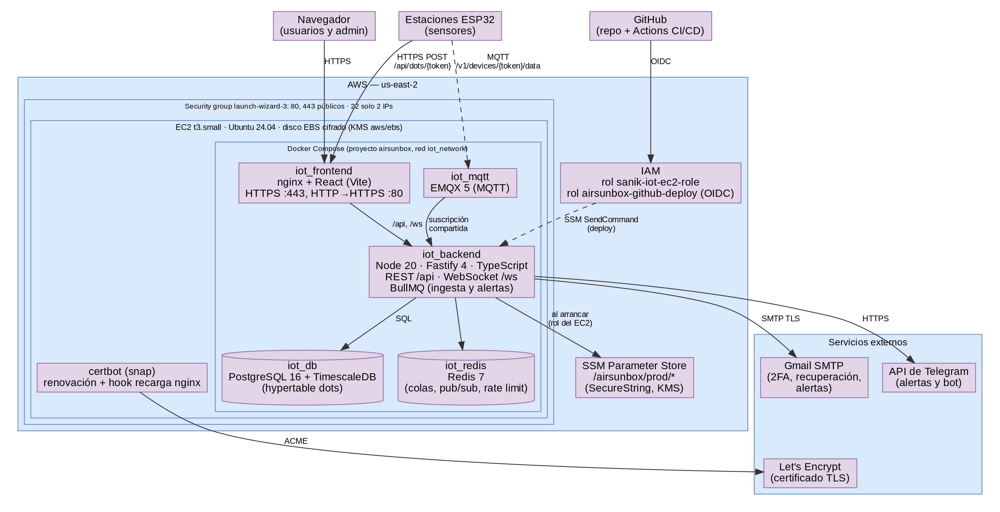
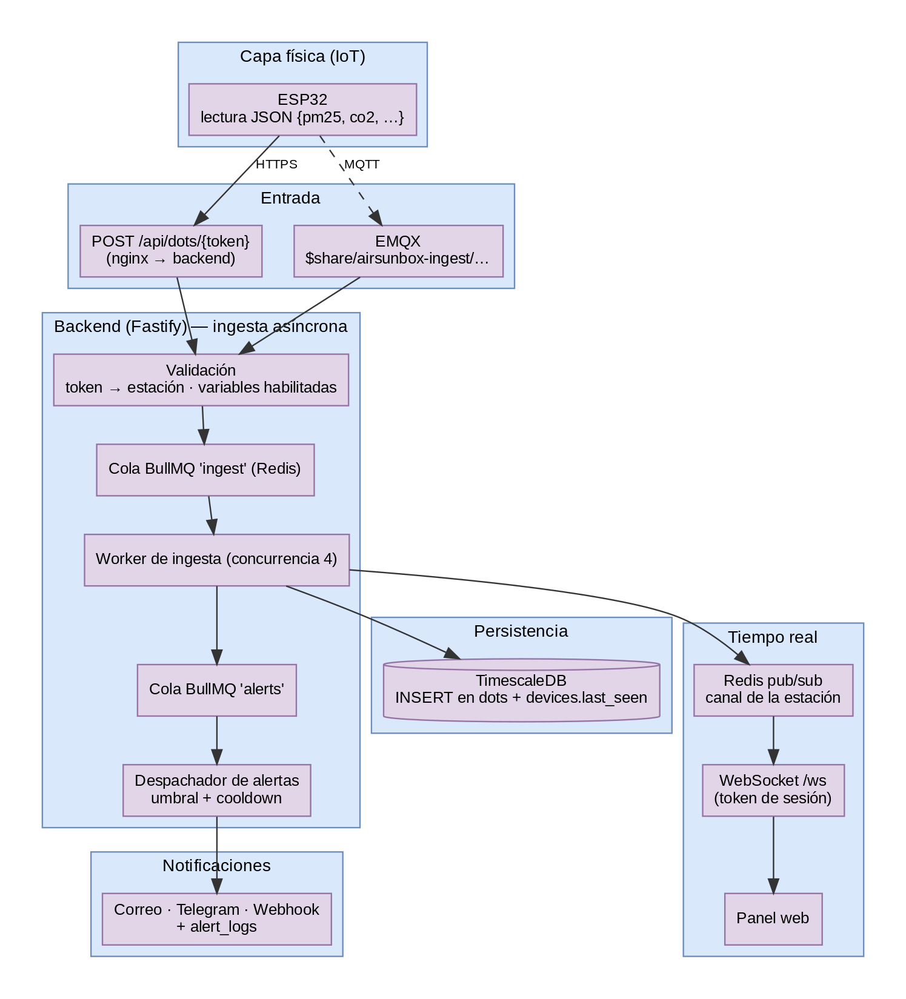
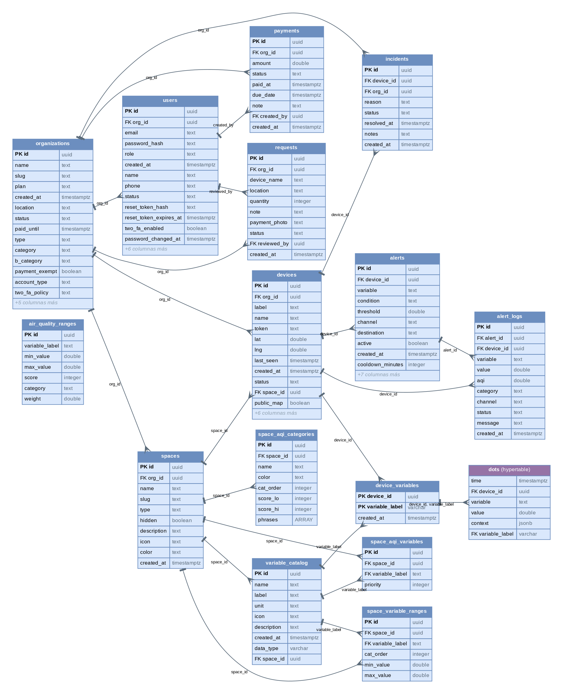
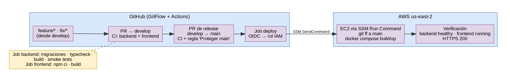

[TOC]

# 1. Introducción

## 1.1 Propósito

Este manual describe cómo está construida y desplegada la plataforma **AirSunBox**:
su arquitectura, sus componentes, el modelo de datos, los mecanismos de
seguridad y la trazabilidad entre los requisitos y el código. Está dirigido a
desarrolladores y operadores que necesitan entender, mantener o ampliar el
sistema. La operación diaria (desplegar, volver atrás, monitorear y atender
incidentes) está en el documento complementario **Guía de despliegue y Runbook**.

## 1.2 Alcance

AirSunBox es una plataforma IoT de monitoreo ambiental. Estaciones con
microcontroladores ESP32 miden variables como PM2.5, PM10, CO₂, O₃, NOx, SO₂,
temperatura y humedad, y envían sus lecturas a la nube. La plataforma:

- recibe, valida y almacena las lecturas como series de tiempo;
- las muestra en tiempo real en paneles por organización y en un mapa público;
- calcula un índice de calidad del aire (AQI) configurable por espacio;
- genera alertas por correo, Telegram o webhook cuando se superan umbrales;
- produce reportes (mapa de calor, riesgo respiratorio, registros por estación)
  exportables a PDF y Excel;
- administra organizaciones cliente, su equipo interno, solicitudes y pagos.

## 1.3 Entorno de producción

| Elemento | Valor |
|---|---|
| URL pública | `https://18.223.121.208` (la instancia está detenida fuera de los periodos de demostración; al encenderla cambia la IP) |
| Proveedor | Amazon Web Services, región `us-east-2` (Ohio) |
| Cómputo | 1 instancia EC2 `t3.small` (2 vCPU, 2 GB RAM), Ubuntu 24.04 |
| Repositorio | `github.com/JCR2005/AirSunBox` (ramas `main` y `develop`) |

# 2. Descripción general

## 2.1 Roles

| Rol | Organización | Qué puede hacer |
|---|---|---|
| `superadmin` | Interna (AirSunBox) | Todo; único que crea o modifica administradores y otros superadministradores |
| `admin` | Interna | Gestiona clientes, estaciones, variables, solicitudes y trabajadores |
| `worker` | Interna | Panel interno y solicitudes |
| `client` | Cliente | Administra su organización: espacios, estaciones, alertas y reportes |

El usuario `client` es el **administrador de su organización**: es quien
consulta y exporta los reportes de métricas de sus estaciones.

## 2.2 Tipos de organización

- **Tipo A (dependiente):** gestionada por el equipo AirSunBox; usa el catálogo
  global de variables.
- **Tipo B (independiente / autogestionada):** el cliente crea sus propios
  espacios, variables, rangos de AQI y estaciones.

## 2.3 Conceptos del dominio

| Concepto | Descripción |
|---|---|
| Organización | Cliente de la plataforma (municipalidad, universidad, empresa o persona) |
| Espacio | Agrupación lógica de estaciones (una zona, un edificio) con su propia configuración de AQI |
| Estación (*device*) | Equipo físico con un **token** único con el que envía sus lecturas |
| Variable | Magnitud medida (`pm25`, `co2`, `temperatura`…) con unidad y rangos. En los espacios de organizaciones independientes, cada variable tiene una **clave de estación** (`station_key`), única dentro del espacio, que es la que envía el equipo; internamente se guarda con su `label` global |
| Lectura (*dot*) | Valor de una variable de una estación en un instante |
| Alerta | Regla “si la variable X supera el umbral Y, avisar por el canal Z” |

# 3. Arquitectura

## 3.1 Vista de despliegue



Todo el sistema corre en una instancia EC2 con **Docker Compose**
(proyecto `airsunbox`, red interna `iot_network`). Solo nginx publica puertos
hacia internet (80 y 443); la base de datos, Redis y el panel de EMQX escuchan
únicamente en la red interna o en `127.0.0.1`.

| Contenedor | Imagen | Puertos | Responsabilidad |
|---|---|---|---|
| `iot_frontend` | build propio (`node:20-alpine` → `nginx:alpine`) | 80, 443 públicos | Sirve la SPA de React; termina TLS; proxy de `/api` y `/ws` al backend; cabeceras de seguridad |
| `iot_backend` | build propio (`node:20-alpine`) | 3000 (solo red interna) | API REST, WebSocket, ingesta, colas, alertas, reportes |
| `iot_db` | `timescale/timescaledb:latest-pg16` | 5432 (solo `127.0.0.1:5434`) | PostgreSQL 16 con TimescaleDB |
| `iot_redis` | `redis:7-alpine` | 6379 (solo `127.0.0.1`) | Colas BullMQ, pub/sub en tiempo real, límites de peticiones, caché de revocación |
| `iot_mqtt` | `emqx:5` | 1883/8883 (no abiertos en el security group) | Broker MQTT para estaciones que publican por MQTT |

Servicios externos: Gmail SMTP (correo transaccional), API de Telegram
(alertas y bot), Let’s Encrypt (certificado TLS), AWS SSM Parameter Store
(secretos) y GitHub Actions (CI/CD).

## 3.2 Estilo arquitectónico

El backend es un **monolito modular** en Fastify. Cada módulo de negocio sigue
la misma separación en capas:

```
routes/        → validación de entrada (TypeBox), autorización por rol, respuesta HTTP
services/      → reglas de negocio (auth, AQI, alertas, organizaciones, reportes)
repositories/  → consultas SQL parametrizadas (pg)
plugins/       → infraestructura compartida: db, redis, mqtt, colas, tiempo real
lib/           → utilidades: secretos (SSM), correo, URLs seguras, token Bearer
```

El frontend es una **SPA** en React 18 + Vite, con Zustand para el estado de
sesión y Tailwind para estilos. nginx la sirve como archivos estáticos.

## 3.3 Flujo de una lectura



1. La estación envía un JSON con sus variables a `POST /api/dots/{token}`
    (HTTPS a través de nginx) o publica en el tópico MQTT
    `/v1/devices/{token}/data`.

2. El backend identifica la estación por su token y descarta variables que no
    tiene habilitadas.

3. La lectura entra a la cola BullMQ `ingest` (Redis). Así la API responde
    rápido aunque la base esté ocupada, y un pico de envíos no se pierde.

4. El worker de ingesta (concurrencia configurable, 4 por defecto) inserta en
    la hypertable `dots` y actualiza `devices.last_seen`.

5. El worker publica la lectura en el canal Redis de la estación; el plugin de
    tiempo real la reenvía por **WebSocket** (`/ws`) a los navegadores
    suscritos, que validaron su sesión con el token JWT.

6. El worker encola la evaluación de alertas (cola `alerts`). El despachador
    aplica umbral y *cooldown* y avisa por correo, Telegram o webhook; cada
    disparo queda en `alert_logs`.

Con varias réplicas del backend, la suscripción MQTT es **compartida**
(`$share/airsunbox-ingest/...`): cada mensaje lo procesa una sola réplica.

## 3.4 Infraestructura en AWS

| Recurso | Configuración |
|---|---|
| EC2 | `i-07a637df8369c3f6c`, `t3.small`, zona `us-east-2c`, IMDSv2 obligatorio |
| Disco | EBS gp3 de 20 GB **cifrado con KMS** (`aws/ebs`); cifrado EBS por defecto activado en la región |
| Security group | `launch-wizard-3`: 80 y 443 abiertos; 22 solo desde 2 IPs autorizadas |
| Rol de la instancia | `sanik-iot-ec2-role`: SSM Agent + lectura de `/airsunbox/prod/*` (política `airsunbox-leer-secretos`) |
| Rol de despliegue | `airsunbox-github-deploy`, asumido por GitHub Actions vía **OIDC** (sin claves de acceso) |
| Secretos | SSM Parameter Store, `/airsunbox/prod/{JWT_SECRET, DB_PASSWORD, SMTP_PASS}`, tipo SecureString (KMS `aws/ssm`) |
| IaC | Terraform en `terraform/`, estado remoto en S3 (cifrado, con bloqueo) |
| Certificado | Let’s Encrypt para la IP, renovado por certbot (snap) con *hook* que recarga nginx |

# 4. Stack tecnológico

| Capa | Tecnología | Versión |
|---|---|---|
| Backend | Node.js · Fastify · TypeScript | 20 · 4.29 · 7 |
| Validación / docs API | TypeBox · Swagger (`/docs`, solo red interna) | — |
| Base de datos | PostgreSQL + TimescaleDB | 16 |
| Colas y tiempo real | Redis · BullMQ · WebSocket (`@fastify/websocket`) | 7 · 5.8 |
| Mensajería IoT | EMQX (MQTT) · cliente `mqtt` | 5 · 5.15 |
| Correo | nodemailer (Gmail SMTP, TLS) | 10 |
| Frontend | React · React Router · Vite · Tailwind CSS · Zustand | 18.3 · 6.26 · 5.4 · 3.4 · 4.5 |
| Mapas y gráficos | Leaflet / React-Leaflet · Recharts | 1.9 · 2.12 |
| Exportación | jsPDF + html2canvas (PDF) · SheetJS `xlsx` (Excel) | 4.2 · 0.18 |
| Infraestructura | Docker Compose · nginx · AWS (EC2, EBS, IAM, SSM, KMS) · Terraform | — |
| CI/CD | GitHub Actions (OIDC + SSM Run Command) | — |

# 5. Backend

## 5.1 Punto de entrada

`src/server.ts` carga primero los secretos y después la aplicación:

1. lee `backend/.env` (configuración no secreta);
2. si existe `SSM_SECRETS_PATH`, obtiene `JWT_SECRET`, `DB_PASSWORD` y
    `SMTP_PASS` de SSM Parameter Store con el rol de la instancia
    (`src/lib/secrets.ts`); si SSM no responde y falta alguno, **no arranca**;

3. importa `src/app.ts`, que registra plugins, rutas y el WebSocket.

## 5.2 Módulos de la API

| Prefijo | Módulo | Responsabilidad |
|---|---|---|
| `/api/auth` | `routes/auth.ts` | Login, 2FA, sesión, logout, registro, recuperación de contraseña, equipo interno |
| `/api/organizations` | `routes/organizations.ts` | Clientes: alta, edición, estado, credenciales |
| `/api/spaces` | `routes/spaces.ts` | Espacios y su configuración de AQI |
| `/api/devices` | `routes/devices.ts` | Estaciones, variables habilitadas, últimos valores, AQI, ficha técnica y foto del equipo |
| `/api/variables` | `routes/variables.ts` | Catálogo de variables y rangos |
| `/api/dots` | `routes/dots.ts` | Ingesta (`POST /:deviceToken`) y consultas de series |
| `/api/alerts` | `routes/alerts.ts` | Reglas de alerta, historial y envío de prueba |
| `/api/reports` | `routes/reports.ts` | Estadísticas, mapa de calor, riesgo respiratorio, reporte de espacio |
| `/api/requests` | `routes/requests.ts` | Solicitudes de estaciones |
| `/api/payments` | `routes/payments.ts` | Pagos de clientes |
| `/api/incidents` | `routes/incidents.ts` | Incidencias de estaciones o generales, avisos al equipo |
| `/api/public` | `routes/publicRoutes.ts` | Mapa y reportes públicos (sin sesión) |

El catálogo completo de endpoints está en el **Anexo A**.

## 5.3 Autenticación y sesiones

- **Login** con correo y contraseña (bcrypt, costo 10). Si la cuenta tiene 2FA
  (o la política de su organización lo exige) se devuelve un token temporal
  `otp_pending` de 10 minutos que solo sirve para `/api/auth/otp/verify`.
- **2FA por correo:** código de 6 dígitos generado con `crypto.randomInt`,
  guardado con bcrypt, válido 10 minutos; 3 intentos fallidos bloquean 15
  minutos. Hay códigos de respaldo de un solo uso.
- **Sesión:** JWT HS256 firmado con `JWT_SECRET`, vigencia de 24 h
  (`JWT_EXPIRES_IN`). Se envía en `Authorization: Bearer`.
- **Revocación:**
    - *Cerrar sesión* (`POST /api/auth/logout`) guarda el SHA-256 del token en
    Redis hasta su vencimiento; el token queda rechazado en HTTP y WebSocket.
    - *Cambio de contraseña* (recuperación o reinicio por un admin) registra
    `users.password_changed_at`; todo token emitido antes se rechaza con
    `401 SESSION_REVOKED` en todos los dispositivos.

- **Recuperación de contraseña:** enlace con token aleatorio de 256 bits
  guardado como SHA-256, válido **10 minutos**, de un solo uso (se consume en
  el mismo `UPDATE` que cambia la contraseña), anulado al pedir otro o si un
  admin cambia la contraseña. La pantalla valida el enlace al abrirse
  (`POST /api/auth/reset-password/check`).
- **Límite de peticiones:** 10 por minuto por IP en login, registro, 2FA y
  recuperación; límite general en el resto (Redis).

## 5.4 Tiempo real, colas y observabilidad

| Elemento | Detalle |
|---|---|
| WebSocket `/ws` | El cliente envía `{type:'auth', token}` y luego `{type:'subscribe', deviceId}`; solo recibe estaciones que puede ver |
| Cola `ingest` | BullMQ sobre Redis; worker con `INGEST_WORKER_CONCURRENCY` (4) |
| Cola `alerts` | Evaluación y despacho de alertas con *cooldown* por regla |
| `GET /health` | Estado del servicio; lo usa el *healthcheck* de Docker |
| `GET /metrics` | Métricas Prometheus (`prom-client`), solo red interna |
| `GET /docs` | Documentación Swagger de la API, solo red interna |
| Logs | JSON estructurado (pino) en la salida estándar del contenedor |

# 6. Frontend

## 6.1 Estructura

```
src/pages/          → pantallas (cliente, admin, públicas, autenticación)
src/components/     → layout, menú de usuario, seguridad (2FA), recuperación, mapas
src/services/api.js → cliente HTTP: token, manejo de 401 y de SESSION_REVOKED
src/store/auth.js   → sesión (Zustand + localStorage), logout con revocación
src/utils/exportUtils.js → reportes PDF (jsPDF) y Excel (SheetJS)
```

## 6.2 Rutas por rol

| Ruta | Pantalla | Acceso |
|---|---|---|
| `/`, `/mapa` | Landing y mapa público | Público |
| `/login`, `/forgot-password`, `/reset-password` | Acceso y recuperación | Público |
| `/espacios`, `/espacios/:id`, `/espacios/:id/aqi` | Espacios, panel del espacio, configuración AQI | Cliente |
| `/dashboard`, `/devices/:id`, `/variableDetail/...` | Panel, estación, detalle de variable | Cliente |
| `/alerts`, `/reportes`, `/profile` | Alertas, reportes, perfil editable y 2FA | Cliente (perfil: todos) |
| `/solicitudes` | Solicitudes de estaciones | Cliente de organización dependiente |
| `/incidencias` | Reportar incidencias y ver su estado | Cliente |
| `/admin`, `/admin/solicitudes`, `/admin/incidencias` | Panel interno, solicitudes, incidencias | superadmin, admin, worker |
| `/admin/clientes`, `/admin/variables` | Clientes, catálogo de variables | superadmin, admin |
| `/admin/equipo` | Equipo interno | superadmin |

## 6.3 Reportes exportables

| Reporte | Pantalla | PDF | Excel | Fuente de datos |
|---|---|---|---|---|
| Mapa de calor (islas de calor) | Reportes | Sí | Sí | `GET /api/reports/heatmap` |
| Riesgo respiratorio | Reportes | Sí | Sí | `GET /api/reports/respiratory-risk` |
| Reporte de espacio (organizaciones independientes): niveles propios del espacio, horas por nivel, serie diaria, perfil por hora, máximos, cobertura por estación, alertas e incidencias; para todo el espacio o una estación | Reportes | Sí | Sí | `GET /api/reports/space/:spaceId` |
| Registros de una estación | Detalle de variable | Sí | Sí | `GET /api/dots/:deviceId/records` |
| Resumen semanal | Estación / variable | Sí | — | `GET /api/dots/:deviceId/weekly` |

Los archivos se generan en el navegador a partir de los datos que devuelve la
API, que los consulta en la base de producción.

# 7. Modelo de datos

## 7.1 Diagrama entidad-relación



El diagrama se generó desde la base con todas las migraciones aplicadas
(`docs/diagramas/modelo-datos.dot`). Por legibilidad se omiten algunas columnas
secundarias, indicadas como “+N columnas más”.

## 7.2 Diccionario de datos (resumen)

| Tabla | Propósito | Columnas clave |
|---|---|---|
| `organizations` | Clientes y organización interna `airsunbox-internal` | `slug`, `type` (A/B), `plan`, `status`, `paid_until`, `two_fa_policy` |
| `users` | Usuarios de todas las organizaciones | `email`, `password_hash` (bcrypt), `role`, `status`, `two_fa_enabled`, `reset_token_hash`, `password_changed_at` |
| `spaces` | Espacios de una organización | `org_id`, `type`, `hidden`, `color`, `icon` |
| `devices` | Estaciones | `org_id`, `space_id`, `token` (único), `lat`, `lng`, `last_seen`, `public_map`, `hardware` (jsonb: serie, placa, sensores) |
| `device_photos` | Foto del equipo instalado (una por estación) | `device_id`, `image` (data URL), `updated_at` |
| `variable_catalog` | Catálogo de variables (global o por espacio) | `label`, `unit`, `data_type`, `space_id`, `station_key` (única por espacio) |
| `device_variables` | Variables habilitadas por estación | PK (`device_id`, `variable_label`) |
| `dots` | **Lecturas** (hypertable TimescaleDB) | `time`, `device_id`, `variable_label`, `value`, `context` (jsonb) |
| `air_quality_ranges` | Rangos de AQI por defecto | `variable_label`, `min_value`, `max_value`, `score`, `category` |
| `space_aqi_categories` / `space_aqi_variables` / `space_variable_ranges` | Configuración de AQI propia de cada espacio | `space_id`, `cat_order`, rangos, prioridad, frases |
| `alerts` / `alert_logs` | Reglas de alerta y su historial | `variable`, `condition`, `threshold`, `channel`, `cooldown_minutes` |
| `requests` | Solicitudes de estaciones de los clientes | `status` (pending, in_review, approved, rejected), `reviewed_by` |
| `payments` | Pagos registrados | `amount`, `status`, `due_date`, `paid_at` |
| `incidents` | Incidencias de estaciones (o generales, sin `device_id`) | `reason`, `status` (`open`, `in_review`, `resolved`), `notes`, `resolved_at` |

## 7.3 Series de tiempo

`dots` es una **hypertable** de TimescaleDB particionada por `time`, con
compresión activada (migración v19) para los *chunks* antiguos. Su clave
foránea compuesta a `device_variables` garantiza que solo se guarden variables
habilitadas en la estación. Las consultas de los paneles agregan por intervalos
(`time_bucket`) en lugar de leer lecturas crudas.

## 7.4 Migraciones

Las migraciones están en `plataforma-iot-airsunbox/database/` y son
**idempotentes** (`IF NOT EXISTS`, `ON CONFLICT`). El script
`database/initdb/00-schema.sh` las aplica en orden:

| Orden | Archivo | Contenido |
|---|---|---|
| 1–3 | `init.sql`, `database-v2.sql`, `aqi.sql` | Esquema base, organizaciones y AQI |
| 4–7 | `v6`, `v8`, `v9`, `v10` | Íconos de espacio, variables por espacio, recuperación de contraseña, variables visibles |
| 8–9 | `v11`, `v12` | Motor de alertas y canal Telegram |
| 10–13 | `v13`, `v15`, `v16`, `v17` | Color de espacio, OTP/2FA, ajustes de H₂S |
| 14–16 | `migrate-full.sql`, `v7`, `v14` | Consolidación, *backfill*, mapa público y frases |
| 17–22 | `v18`–`v22` | Bandera 2FA sin contraseñas en texto plano, compresión de `dots`, alineación con producción, organización interna, `password_changed_at` |
| 23–24 | `v23`, `v24` | Clave de estación por espacio (`station_key`); ficha técnica (`devices.hardware`) y foto del equipo (`device_photos`) |

Se ejecutan automáticamente:

- al crear una base nueva (Postgres corre `00-schema.sh` desde
  `docker-entrypoint-initdb.d`);
- en **cada ejecución del CI**, sobre una base vacía, antes de compilar y
  probar el backend.

En una base existente, una migración nueva se aplica con `psql` (ver Runbook,
sección 4).

# 8. Seguridad

| Control | Implementación |
|---|---|
| Cifrado en tránsito | HTTPS con Let’s Encrypt, solo TLS 1.2/1.3; HTTP redirige a HTTPS; HSTS |
| Cabeceras HTTP | `X-Frame-Options: DENY`, `X-Content-Type-Options: nosniff`, `Referrer-Policy`, `Permissions-Policy`, CSP mínima, `server_tokens off` |
| Cifrado en reposo | Disco EBS cifrado con KMS; secretos SecureString (KMS); estado de Terraform cifrado en S3 |
| Contraseñas | bcrypt (costo 10), mínimo 8 caracteres; nunca en texto plano |
| 2FA | Código por correo de 10 min, hash bcrypt, bloqueo tras 3 intentos, códigos de respaldo |
| Sesiones | JWT de 24 h; revocación por logout y por cambio de contraseña (HTTP y WebSocket) |
| Recuperación | Token de 256 bits, SHA-256, 10 min, un solo uso, consumo atómico |
| Secretos | AWS SSM Parameter Store + KMS; el código no tiene valores por defecto; el repositorio no contiene secretos |
| Mínimo privilegio | Rol del EC2 limitado a leer `/airsunbox/prod/*`; despliegue por OIDC sin claves; reglas de rol en cada endpoint |
| Red | Security group con 80/443; SSH solo desde 2 IPs; base de datos, Redis y EMQX sin exposición pública |
| Abuso | Límite de peticiones por IP (Redis); validación de entrada con TypeBox; protección SSRF en webhooks (`lib/safeUrl.ts`) |
| CORS | Lista de orígenes permitidos (más `CORS_ORIGINS`) |
| Rama protegida | Regla “Proteger main”: PR obligatorio y checks `backend` y `frontend` en verde |

# 9. Integración y despliegue continuos



- **GitFlow:** el trabajo se hace en ramas `feature/*`, `fix/*` o `docs/*`
  creadas desde `develop`; entran por *pull request*. Un PR de *release*
  lleva `develop` a `main`.
- **CI** (`.github/workflows/ci.yml`), en cada push y PR a `develop` y `main`:
    - job `backend`: levanta TimescaleDB y Redis, aplica todas las migraciones,
    typecheck, build, arranca el backend y corre las pruebas de humo
    (`tests/smoke.mjs`);
    - job `frontend`: instalación y build de producción.

- **CD:** al hacer merge en `main`, el job `deploy` asume el rol IAM por OIDC y
  ejecuta en el EC2, mediante SSM Run Command:
    1. avance rápido del repositorio al commit probado;
    2. `docker compose build` y `up` de backend y frontend;
    3. verificación de backend `healthy`, frontend `running` y HTTPS 200.

  No hay pasos manuales.

# 10. Trazabilidad

Trazabilidad de los requisitos oficiales del documento *Requisitos funcionales
y no funcionales* (RF01–RF50, RNF01–RNF09) hacia la pantalla, el endpoint, el
código que los implementa y su estado en la versión desplegada.

Estado: **Hecho** (implementado y desplegado), **Parcial** (implementado en
parte; se indica qué falta) o **Pendiente**.

## 10.1 Requisitos funcionales

| RF | Requisito | Pantalla / Endpoint | Código | Estado |
|---|---|---|---|---|
| RF01 | Inicio de sesión (JWT) | `/login` · `POST /api/auth/login` | `services/authService.ts` | Hecho |
| RF02 | Recuperación de contraseña propia | `/forgot-password`, `/reset-password` · `/api/auth/forgot-password`, `/reset-password/check`, `/reset-password` | `authService.ts`, `repositories/users.ts` | Hecho |
| RF03 | Autenticación de dos factores (2FA) | `/login`, `/profile` · `/api/auth/otp/verify`, `/api/auth/2fa/*` | `services/otpService.ts` | Hecho |
| RF04 | Visualización del perfil | `/profile` · `GET /api/auth/me` | `routes/auth.ts`, `pages/Profile.jsx` | Hecho |
| RF05 | Edición del perfil personal y de la organización | `PATCH /api/auth/me`, `/profile` | `routes/auth.ts`, `pages/Profile.jsx` | Hecho (nombre y teléfono propios; los datos de la organización los edita el equipo interno, RF12) |
| RF06 | Solicitud de contacto con soporte | `/incidencias` (incidencia general), landing *Contacto* | `pages/ClientIncidents.jsx`, `pages/Landing.jsx` | Hecho (el cliente escribe a soporte con una incidencia general; los visitantes ven los datos de contacto) |
| RF07 | Dashboard administrativo | `/admin` · `GET /api/reports/stats`, `/api/requests`, `/api/organizations` | `pages/admin/Dashboard.jsx` | Hecho |
| RF08 | Búsqueda de organizaciones | `/admin/clientes` (buscador) | `pages/admin/Clients.jsx` | Hecho |
| RF09 | Listado de organizaciones | `/admin/clientes` · `GET /api/organizations` | `routes/organizations.ts` | Hecho |
| RF10 | Registro de organización (tipo dependiente / control total) | `/admin/clientes` · `POST /api/organizations`; autoregistro `POST /api/auth/register` | `services/organizationsService.ts` | Hecho |
| RF11 | Detalle de organización | `/admin/clientes/:id` · `GET /api/organizations/:id` | `pages/admin/ClientDetail.jsx` | Hecho |
| RF12 | Edición de datos de organización | `/admin/clientes/:id` · `PUT /api/organizations/:id` | `routes/organizations.ts` | Hecho |
| RF13 | Suspensión y reactivación de organización | `PATCH /api/organizations/:id/status` | `routes/organizations.ts` | Hecho |
| RF14 | Restablecimiento de contraseña de organización | `POST /api/organizations/:id/reset-client-password` | `organizationsService.ts` (revoca sesiones) | Hecho |
| RF15 | Revelación de credenciales de organización | `POST /api/organizations/:id/reveal-credentials` (exige la contraseña del admin) | `organizationsService.ts` | Hecho |
| RF16 | Creación directa de estación por el administrador | `/admin/clientes/:id` · `POST /api/devices` | `routes/devices.ts` | Hecho |
| RF17 | Token único por estación | `devices.token` (24 bytes aleatorios) | `routes/devices.ts` | Hecho |
| RF18 | Dashboard de estaciones (resumen, mapa, estado) | `/dashboard`, `/espacios/:id` · `GET /api/devices` | `pages/Dashboard.jsx` | Hecho |
| RF19 | Detalle de estación | `/devices/:id` · `GET /api/devices/:id`, `/last-values` | `pages/DeviceDetail.jsx` | Hecho |
| RF20 | Visualización del catálogo de variables | `/admin/variables` · `GET /api/variables/catalog` | `routes/variables.ts` | Hecho |
| RF21 | Alta de variable en el catálogo | `POST /api/variables/catalog` | `routes/variables.ts` | Hecho |
| RF22 | Eliminación de variable del catálogo | `DELETE /api/variables/catalog/:label` | `routes/variables.ts` | Hecho |
| RF23 | Cálculo automático del índice de calidad | `GET /api/devices/:id/aqi`, `POST /api/spaces/:id/aqi/calculate` | `services/aqiService.ts` | Hecho |
| RF24 | Configuración editable del AQI general (administrador) | `/espacios/:id/aqi` · `PUT /api/spaces/:id/aqi` | `routes/spaces.ts` | Parcial (el AQI se configura por espacio; los rangos generales de `air_quality_ranges` no se editan desde la interfaz) |
| RF25 | Recepción de datos vía MQTT | Tópico `/v1/devices/{token}/data` (y `POST /api/dots/:deviceToken`) | `plugins/mqtt.ts`, `services/ingestQueue.ts` | Hecho |
| RF26 | Almacenamiento histórico (series de tiempo) | Hypertable `dots` (TimescaleDB, comprimida) | `database/v19-dots-compression.sql` | Hecho |
| RF27 | Actualización en tiempo real | WebSocket `/ws` | `plugins/realtime.ts` | Hecho |
| RF28 | Gráfica histórica con filtros y agregación | `/variableDetail/...` · `GET /api/dots/:deviceId/:variable` | `repositories/dots.ts` (`time_bucket`) | Hecho |
| RF29 | Exportación del historial de una variable | `/variableDetail/...` · `GET /api/dots/:deviceId/records` (PDF y Excel) | `utils/exportUtils.js` | Hecho |
| RF30 | Configuración de alertas por variable y estación | `/alerts` · `POST /api/alerts` | `routes/alerts.ts` | Hecho |
| RF31 | Activación y desactivación de alertas | `PATCH /api/alerts/:id` | `routes/alerts.ts` | Hecho |
| RF32 | Notificación automática al superar umbral (correo/webhook) | Cola `alerts`; correo, Telegram y webhook | `services/alertDispatcher.ts`, `lib/safeUrl.ts` | Hecho |
| RF33 | Registro de incidencia | `POST /api/incidents`, `/incidencias` | `routes/incidents.ts`, `pages/ClientIncidents.jsx` | Hecho |
| RF34 | Visualización de incidencias | `GET /api/incidents`, `/incidencias`, `/admin/incidencias` | `pages/ClientIncidents.jsx`, `pages/admin/Incidents.jsx` | Hecho |
| RF35 | Resolución de incidencias | `PATCH /api/incidents/:id/review` y `/resolve` | `routes/incidents.ts`, `pages/admin/Incidents.jsx` | Hecho |
| RF36 | Registro de solicitud de nueva estación | `/solicitudes` (solo organizaciones dependientes) · `POST /api/requests` | `pages/ClientRequests.jsx`, `routes/requests.ts` | Hecho |
| RF37 | Visualización de solicitudes | `/admin/solicitudes` · `GET /api/requests` | `pages/admin/Requests.jsx` | Hecho |
| RF38 | Revisión, aprobación o rechazo de solicitudes | `/admin/solicitudes` · `PATCH /api/requests/:id` | `pages/admin/Requests.jsx` | Hecho |
| RF39 | Notificación al equipo sobre solicitudes e incidencias pendientes | Correo al equipo y paneles en `/admin` | `services/teamNotifier.ts`, `pages/admin/Dashboard.jsx` | Hecho |
| RF40 | Estadísticas generales | `/admin` · `GET /api/reports/stats` | `repositories/reports.ts` | Hecho |
| RF41 | Mapas de calor ambientales | `/reportes` · `GET /api/reports/heatmap` | `repositories/reports.ts` | Hecho |
| RF42 | Análisis de riesgo respiratorio | `/reportes` · `GET /api/reports/respiratory-risk` | `services/reportCalculationsService.ts` | Hecho |
| RF43 | Generación de reportes por organización | `/reportes` (filtrado por la organización de la sesión) | `routes/reports.ts` | Hecho |
| RF44 | Exportación de reportes en Excel (.xlsx) y PDF | `/reportes`, detalle de variable | `utils/exportUtils.js` (jsPDF, SheetJS) | Hecho |
| RF45 | Listado de equipo | `/admin/equipo` · `GET /api/auth/team` | `pages/admin/Team.jsx` | Hecho |
| RF46 | Alta de miembro del equipo | `POST /api/auth/users` | `routes/auth.ts` | Hecho |
| RF47 | Cambio de rol de miembro | `PATCH /api/auth/users/:id` | `routes/auth.ts` | Hecho |
| RF48 | Activación y suspensión de miembro | `PATCH /api/auth/users/:id` | `routes/auth.ts` | Hecho |
| RF49 | Consulta pública de calidad del aire | `/mapa` · `GET /api/public/devices`, `/zones/aqi` | `routes/publicRoutes.ts` | Hecho |
| RF50 | Recomendaciones según nivel de riesgo | `/mapa` (recomendación por categoría) | `pages/PublicMap.jsx` | Hecho |

Requisitos planteados “a futuro” en la fase 1 que ya están implementados:
espacios de monitoreo por organización, filtrado por espacio, estaciones
dentro de un espacio, variables destacadas por estación, variables
personalizadas por organización y configuración del AQI por espacio
(`routes/spaces.ts`, `routes/variables.ts`, `pages/Spaces.jsx`,
`pages/SpaceAqi.jsx`).

## 10.2 Requisitos no funcionales

| RNF | Requisito | Cómo se cumple | Verificación |
|---|---|---|---|
| RNF01 | Seguridad | bcrypt, 2FA, JWT con revocación, HTTPS + HSTS, secretos en SSM/KMS, disco cifrado, límite de peticiones (sección 8) | Encabezados con `curl -I`; `Encrypted = true` en el volumen; log “Secretos cargados desde SSM” |
| RNF02 | Rendimiento | Ingesta asíncrona con colas; agregación con `time_bucket`; compresión de `dots` | Paneles sobre más de 560 000 lecturas |
| RNF03 | Escalabilidad | Backend sin estado (sesión en JWT, tiempo real por Redis pub/sub, suscripción MQTT compartida): admite varias réplicas | Diseño (sección 3.3) |
| RNF04 | Compatibilidad | SPA responsive (React + Tailwind) para navegadores modernos | Diseño responsive (Tailwind) |
| RNF05 | Usabilidad | Estados vacíos, validaciones en línea, confirmaciones, tema claro y oscuro | Revisión de pantallas |
| RNF06 | Disponibilidad | Nube (AWS), `restart: unless-stopped`, *healthchecks*, despliegue con verificación, runbook | Job `deploy`; `docker ps` |
| RNF07 | Confiabilidad en la ingesta | Cola persistente en Redis (BullMQ), QoS 1 en MQTT, validación por token | Estaciones reales enviando a producción |
| RNF08 | Aislamiento multi-organización | Cada consulta filtra por `org_id` de la sesión; rutas protegidas por rol | Revisión de código: filtros por `org_id` en repositorios y rutas |
| RNF09 | Extensibilidad | Monolito modular por capas; migraciones versionadas; catálogo de variables configurable | Estructura del código (sección 3.2) |

# 11. Configuración

Variables de entorno del backend (`backend/.env`; plantilla en
`backend/.env.example`). **Los secretos no van en este archivo en producción:
se leen de SSM.**

| Variable | Uso | Secreta |
|---|---|---|
| `SSM_SECRETS_PATH`, `AWS_REGION` | Ruta y región de los secretos en SSM | No |
| `JWT_SECRET` | Firma de sesiones | **Sí (SSM)** |
| `DB_PASSWORD` | Contraseña de PostgreSQL | **Sí (SSM)** |
| `SMTP_PASS` | Contraseña de aplicación de Gmail | **Sí (SSM)** |
| `JWT_EXPIRES_IN` | Vigencia de la sesión (24h) | No |
| `FRONTEND_URL` | Base de los enlaces enviados por correo | No |
| `CORS_ORIGINS` | Orígenes extra permitidos | No |
| `TRUST_PROXY` | Redes confiables para `X-Forwarded-For` | No |
| `SMTP_HOST`, `SMTP_PORT`, `SMTP_SECURE`, `SMTP_USER`, `SMTP_FROM` | Servidor de correo | No |
| `DB_*`, `REDIS_*`, `MQTT_*` | Conexiones internas (las fija `docker-compose.yml`) | No |

# Anexo A. Catálogo de endpoints

| Método | Ruta | Descripción |
|---|---|---|
| POST | `/api/auth/login` | Iniciar sesión |
| POST | `/api/auth/otp/verify` | Verificar código 2FA |
| GET | `/api/auth/2fa/status` | Estado del 2FA |
| POST | `/api/auth/2fa/send-code` · `/2fa/enable` · `/2fa/disable` | Activar o desactivar 2FA |
| POST | `/api/auth/logout` | Cerrar sesión (revoca el token) |
| GET | `/api/auth/me` | Datos de la sesión |
| PATCH | `/api/auth/me` | Editar nombre y teléfono propios |
| POST | `/api/auth/users` | Crear usuario (admin) |
| GET | `/api/auth/team` | Equipo interno |
| PATCH | `/api/auth/users/:id` | Cambiar estado o rol |
| POST | `/api/auth/register` | Registro self-service |
| POST | `/api/auth/forgot-password` | Pedir enlace de recuperación |
| POST | `/api/auth/reset-password/check` | Validar enlace |
| POST | `/api/auth/reset-password` | Cambiar contraseña con el enlace |
| GET/POST | `/api/organizations` | Listar / crear clientes |
| GET/PUT | `/api/organizations/:id` | Ver / editar cliente |
| PATCH | `/api/organizations/:id/status` | Suspender o activar |
| POST | `/api/organizations/:id/reveal-credentials` · `/reset-client-password` | Credenciales del cliente |
| GET/POST | `/api/spaces` | Listar / crear espacios |
| GET/PUT/DELETE | `/api/spaces/:id` | Ver / editar / borrar espacio |
| GET | `/api/spaces/:id/devices` | Estaciones del espacio |
| GET/PUT | `/api/spaces/:id/aqi` | Configuración de AQI |
| POST | `/api/spaces/:id/aqi/calculate` | Calcular AQI |
| GET | `/api/devices/catalog` | Catálogo de equipos |
| GET/POST | `/api/devices` | Listar / crear estaciones |
| GET/PUT/DELETE | `/api/devices/:id` | Ver / editar / borrar estación |
| GET | `/api/devices/:id/variables` · `/last-values` · `/aqi` | Variables, últimos valores, AQI |
| PUT | `/api/devices/:id/spec` | Ficha técnica del equipo |
| GET/PUT | `/api/devices/:id/photo` | Foto del equipo (`null` la quita) |
| GET/POST | `/api/variables/catalog` | Catálogo de variables |
| PUT/DELETE | `/api/variables/catalog/:label` | Editar / borrar variable |
| GET | `/api/variables/ranges/:label` | Rangos de una variable |
| POST | `/api/dots/:deviceToken` | **Ingesta** de lecturas |
| GET | `/api/dots/:deviceId` · `/:deviceId/:variable` · `/raw` | Series agregadas y crudas |
| GET | `/api/dots/:deviceId/weekly` · `/records` | Resumen semanal y registros |
| GET/POST | `/api/alerts`, `/api/alerts/:deviceId` | Reglas de alerta |
| PATCH/DELETE | `/api/alerts/:id` | Activar / borrar alerta |
| GET | `/api/alerts/:deviceId/logs` | Historial de alertas |
| POST | `/api/alerts/:id/test` | Envío de prueba por los canales de la alerta (máximo uno cada 30 s) |
| GET | `/api/reports/stats` · `/heatmap` · `/respiratory-risk` | Reportes |
| GET | `/api/reports/space/:spaceId?start&end&deviceId` | Reporte de un espacio, opcionalmente de una estación |
| GET/POST | `/api/requests` | Solicitudes |
| PATCH | `/api/requests/:id` | Cambiar estado de solicitud |
| GET | `/api/payments/:orgId` | Pagos de un cliente |
| POST | `/api/payments` · PATCH `/api/payments/:id/paid` | Registrar / marcar pagado |
| GET/POST | `/api/incidents` · PATCH `/:id/review` · PATCH `/:id/resolve` | Incidencias (el cliente reporta; el equipo atiende y resuelve) |
| GET | `/api/public/devices` · `/devices/:id/aqi` · `/zones/aqi` | Mapa público |
| GET | `/api/public/reports/stats` | Conteos globales (sin datos de estaciones) |
| GET | `/health` · `/metrics` · `/docs` | Salud, métricas y Swagger (red interna) |
| GET | `/ws` | WebSocket de tiempo real |
