# Introducción

AirSunBox es una plataforma web para monitorear la calidad del aire con
estaciones de medición. Este manual explica, pantalla por pantalla, cómo usar
la plataforma según el rol de cada persona:

| Rol | Quién es | Parte del manual |
|---|---|---|
| **Usuario (cliente)** | Administrador de una organización cliente (municipalidad, universidad, empresa o persona) | Partes 1 y 2 |
| **Administrador** | Equipo interno de AirSunBox: superadministrador, administrador y trabajador | Partes 1 y 3 |
| **Ciudadano** | Cualquier persona, sin cuenta | Parte 4 |

Para usar la plataforma solo se necesita un navegador actualizado (Chrome,
Edge, Firefox o Safari, en computadora o celular) y la dirección
`https://18.223.121.208`. No hay que instalar nada.

# Parte 1. Acceso a la plataforma (todos los roles)

## 1.1 Página de inicio

La página de inicio presenta la plataforma. Desde el menú superior se llega
al **Mapa en vivo** público, a los planes y, con el botón **Ingresar**, al
inicio de sesión.

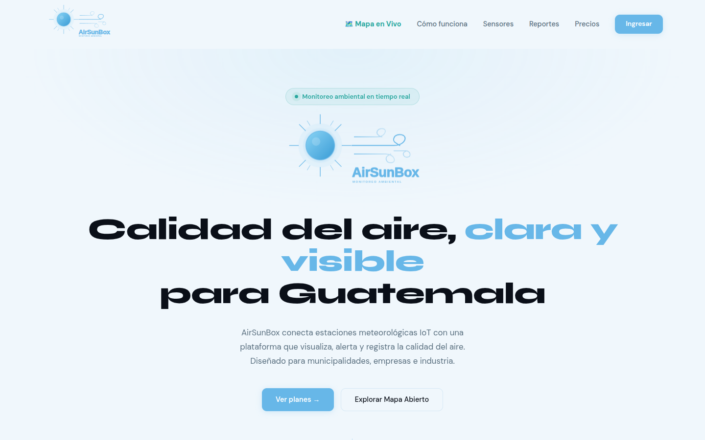

## 1.2 Crear una cuenta

1. En la pantalla de inicio de sesión, elegí **Crear cuenta**.
2. Elegí el tipo de cuenta:
    - **Individual:** para personas, estudiantes o proyectos personales.
    - **Organización:** para municipalidades, universidades o empresas.
3. Completá los datos (nombre de la organización o tu nombre, correo y
   contraseña) y confirmá.

La cuenta creada así es **independiente**: la organización gestiona sus
propios espacios, variables y estaciones (sección 2.1).

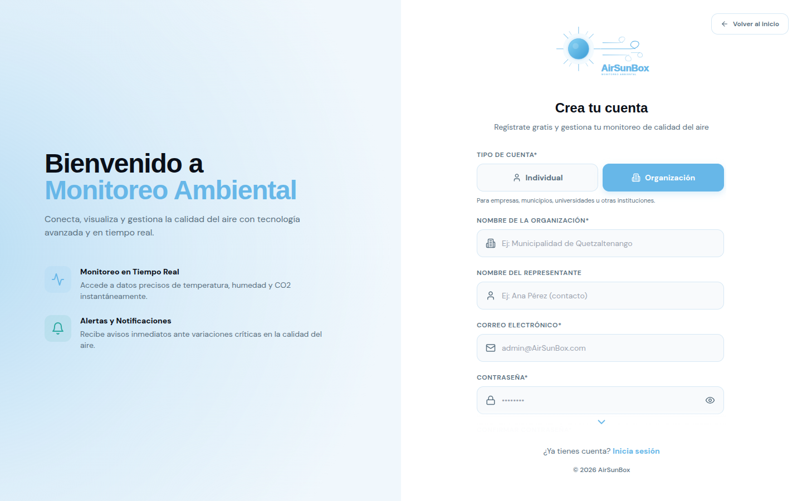

## 1.3 Iniciar sesión

1. Escribí tu **correo** y tu **contraseña** y presioná **Ingresar**.
2. Si tu cuenta tiene activada la **verificación en dos pasos**, la plataforma
   te envía un código de 6 dígitos a tu correo. Escribilo para entrar.
    - El código vale **10 minutos**. Si no llegó, podés pedir otro.
    - Si no tenés acceso al correo, podés usar uno de tus **códigos de
      respaldo**.
    - Después de 3 códigos incorrectos, la cuenta se bloquea 15 minutos.
3. Al entrar, el usuario ve su panel y el administrador ve el panel de control.

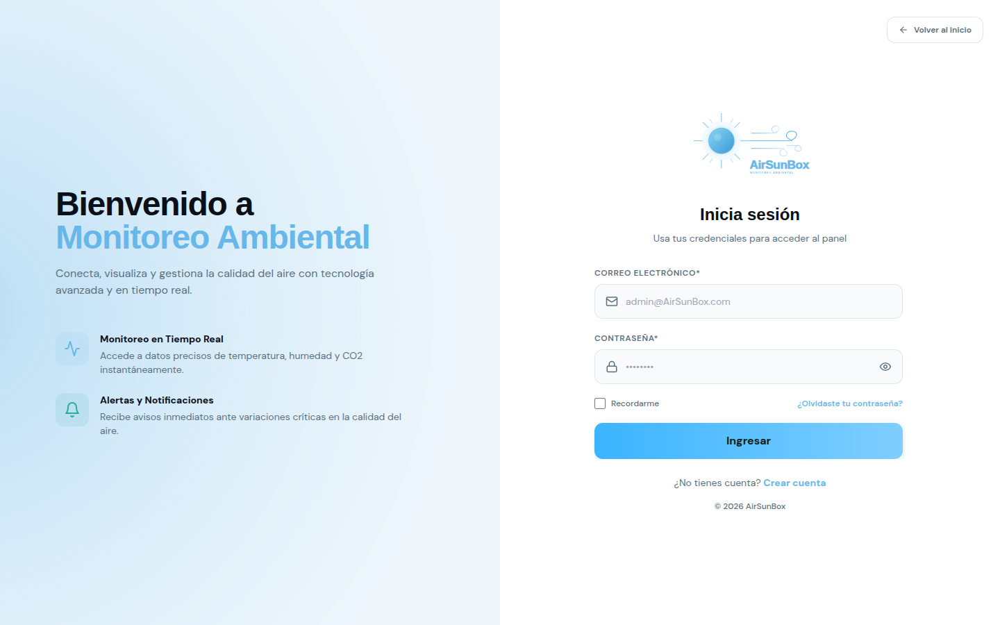

## 1.4 Recuperar la contraseña

Si olvidaste tu contraseña, el proceso tiene tres pasos que se ven a la
izquierda de la pantalla:

1. En el inicio de sesión, elegí **¿Olvidaste tu contraseña?**, escribí el
   correo de tu cuenta y presioná **Enviar enlace**.
2. Revisá tu correo (también la carpeta de spam). El enlace **vale 10 minutos
   y sirve una sola vez**.
3. Abrí el enlace, elegí tu **contraseña nueva** (mínimo 8 caracteres),
   repetila y confirmá.

Por seguridad, al cambiar la contraseña **se cierra tu sesión en todos los
dispositivos**, y después entrás con la contraseña nueva. Si el enlace venció
o ya se usó, la plataforma lo avisa y te ofrece pedir uno nuevo.

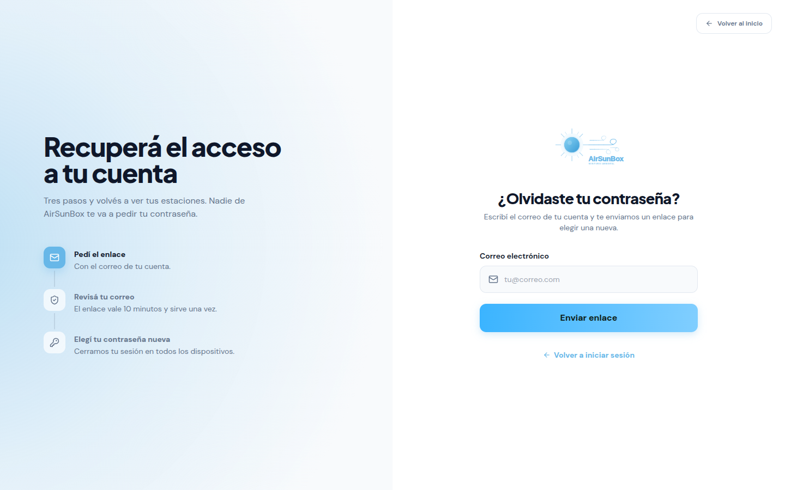

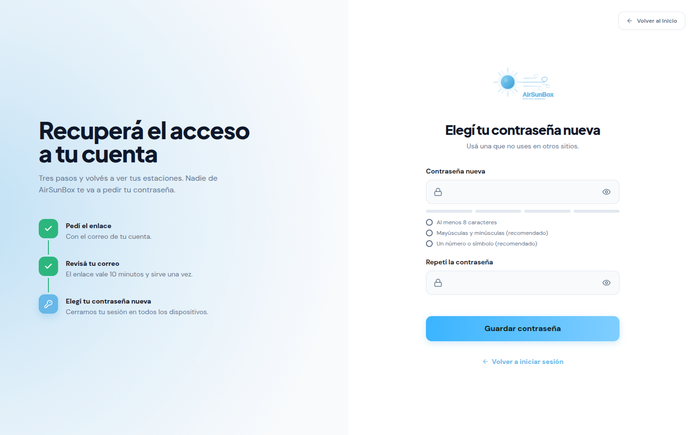

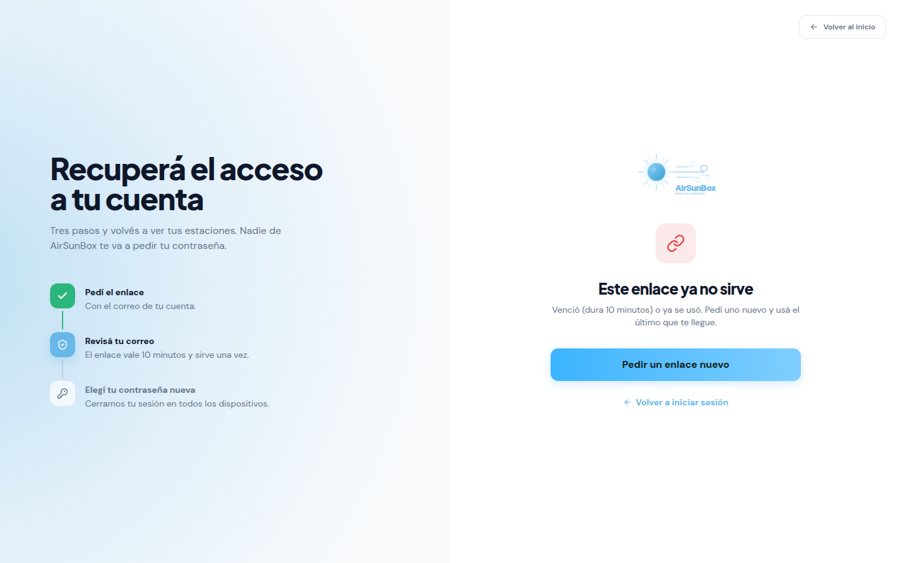

## 1.5 Mi perfil y seguridad

Desde la tarjeta con tu nombre, abajo a la izquierda, abrí **Mi perfil**. Ahí
ves los datos de tu cuenta. Con **Editar**, en la sección **Cuenta**, podés
cambiar tu **nombre** y tu **teléfono**; presioná **Guardar cambios** y el
nombre nuevo aparece también en el menú. El correo, el rol y los datos de la
organización los gestiona el equipo AirSunBox.

En la sección **Seguridad**:

- **Verificación en dos pasos:** con **Activar** la plataforma te envía un
  código para confirmar; al terminar te muestra tus **códigos de respaldo**.
  Guardalos en un lugar seguro.
- **Contraseña:** con **Enviar enlace** recibís por correo el enlace para
  cambiarla (el mismo proceso de la sección 1.4).
- **Cerrar sesión:** desde la misma tarjeta de usuario. La sesión queda
  cerrada también en el servidor.

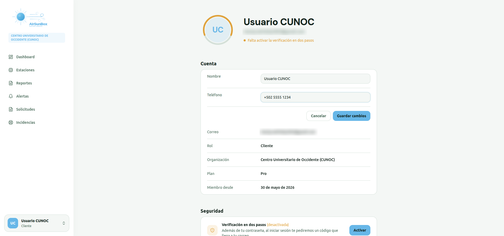

# Parte 2. Guía del usuario (cliente)

## 2.1 Tipos de organización

| Tipo | Quién configura | Qué ve el usuario en el menú |
|---|---|---|
| **Dependiente** | El equipo AirSunBox crea las estaciones y define las variables | Dashboard, Estaciones, Reportes, Alertas, Solicitudes, Incidencias |
| **Independiente** | La propia organización crea espacios, variables, índice de calidad y estaciones | Dashboard, Espacios, Reportes, Alertas, Incidencias |

Las secciones 2.2 a 2.6 y la 2.9 aplican a los dos tipos. La sección 2.7 es
solo para organizaciones dependientes y la 2.8, solo para independientes.

## 2.2 Panel principal

Al entrar, el panel muestra:

- **Tarjetas de resumen:** total de estaciones, estaciones en línea y
  estaciones sin conexión.
- **Mapa de estaciones:** cada punto toma el color de su calidad del aire.
- **Estado de red:** primero aparecen las estaciones que necesitan atención.
  Al hacer clic en una, se abre su detalle.

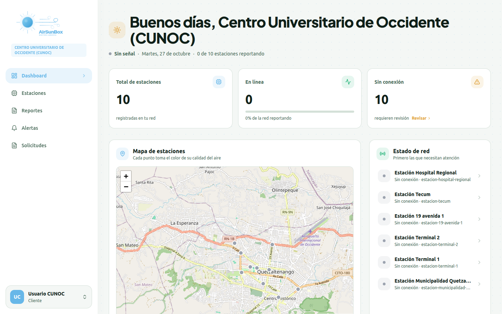

## 2.3 Detalle de una estación

El detalle de una estación tiene dos pestañas: **Resumen** y **Conectar
ESP32**.

En **Resumen**, a la izquierda está la ficha de la estación:

- **Foto del equipo:** se sube desde la ficha y ayuda a reconocer la estación
  en campo.
- **Identificación:** nombre, estado (**En línea** si envió datos en los
  últimos 15 minutos) y espacio al que pertenece. El lápiz edita el nombre,
  la ubicación y la descripción.
- **Conexión:** el **token** de la estación (oculto; se muestra con el ícono
  del ojo y se copia con el botón de copiar), el ID y la última lectura.
- **Equipo:** número de serie, placa y sensores instalados, con **Completar**
  o **Editar**. Sirve para el mantenimiento.
- **Ubicación:** coordenadas y mapa.

A la derecha:

- **Calidad del aire:** el índice (AQI) con su nivel, una recomendación de
  salud y la **variable dominante**: la variable del índice con el peor nivel
  en ese momento. Puede ser un contaminante o, si el espacio la incluyó en el
  índice, otra variable como la humedad. Si la estación no envía datos, el
  indicador queda en gris, sin recomendación.
- **Lecturas actuales:** una tarjeta por variable con su último valor, su
  unidad y una barra que muestra en qué nivel está. Con **Elegir variables**
  se decide cuáles se muestran. Al tocar una tarjeta se abre su historial
  (sección 2.4).

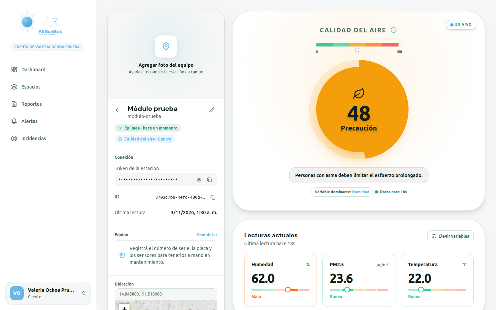

La pestaña **Conectar ESP32** es la guía para programar el equipo:

1. **Dirección de envío:** la URL `POST /api/dots/<token>` lista para copiar.
2. **Qué datos enviar:** la tabla con la **clave** que debe usar el equipo
   para cada variable, su nombre y su unidad, y un ejemplo del JSON.
3. **Código de ejemplo:** un sketch para ESP32/ESP8266 en Arduino IDE; solo
   hay que completar el WiFi y reemplazar los valores de ejemplo por las
   lecturas de los sensores.

## 2.4 Historial de una variable

Al abrir una variable (por ejemplo PM2.5) se ve su gráfica histórica:

1. **Rango de tiempo:** elegí un rango rápido (última hora, hoy, últimos 7
   días, últimos 30 días, últimos 6 meses…) o un rango personalizado, y
   presioná **Update**.
2. **Aggregation:** promedio, mínimo, máximo, suma, conteo o datos crudos.
3. **Sample period:** cada cuánto se agrupan los puntos (de 1 minuto a 6
   horas). En rangos largos la plataforma lo agranda sola para que la gráfica
   siga siendo legible.
4. **Exportar:**
    - **Exportar (.CSV):** los registros de la tabla.
    - **Registros (.PDF)** y **Registros (.XLSX):** todas las variables de la
      estación en el rango elegido.
5. La pestaña **Resumen semanal** muestra la matriz de promedios por día y
   también se puede exportar a PDF.

Debajo de la gráfica, el **historial de registros** lista cada lectura con su
fecha y hora exactas.

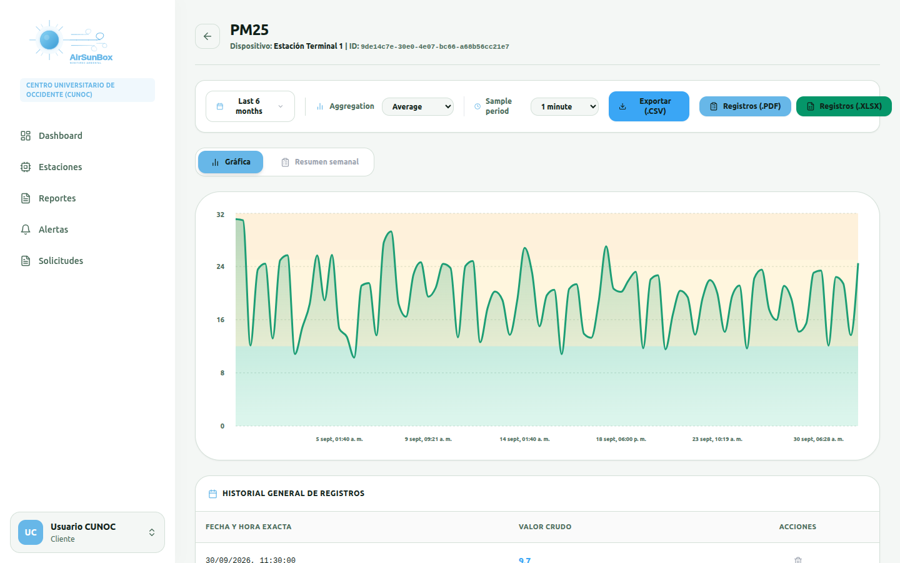

## 2.5 Alertas

1. En **Alertas**, elegí la estación.
2. Presioná **Nueva alerta**. La creación es guiada:
    - **¿Qué querés vigilar?** El índice de calidad de la estación o una
      variable (por ejemplo PM2.5).
    - **¿Cuándo avisar?** Al llegar a un nivel o a uno peor (por ejemplo
      «Precaución o peor»), o con un valor propio y una condición (mayor,
      menor, igual…).
    - **¿Cómo te avisamos?** Correo, Telegram (token del bot e ID del chat) o
      webhook. Se puede elegir más de uno.
    - **Frecuencia y mensaje:** avisar una vez por episodio o repetir cada
      cierto tiempo mientras la condición siga activa, y el texto del aviso.
      El mensaje acepta datos como `{estacion}`, `{variable}`, `{valor}`,
      `{unidad}` o `{hora}`, y la vista **Así llega el aviso** muestra cómo
      queda.
3. Guardá la alerta. En la lista podés activarla o desactivarla con el
   interruptor, **Enviar prueba** para comprobar los canales sin esperar a
   que se cumpla la condición, o **Eliminar** la alerta.
4. **Últimos avisos** muestra cuándo se disparó cada alerta, con qué valor y
   por qué canal.

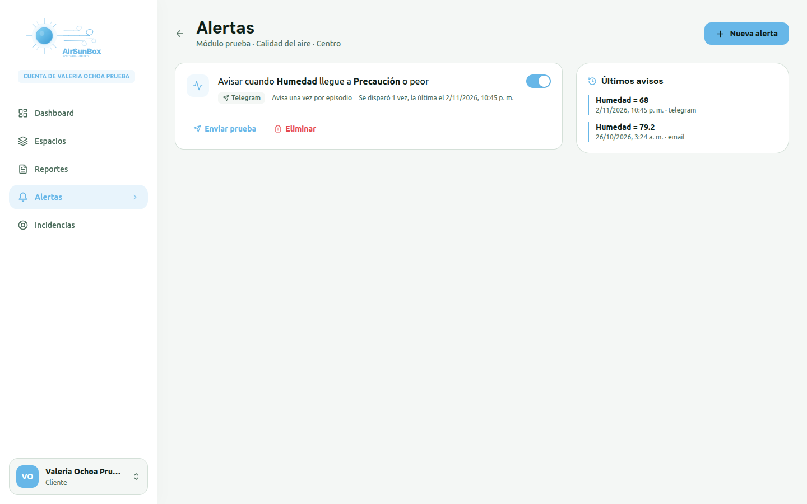

## 2.6 Reportes

Los reportes dependen del tipo de organización.

**Organizaciones dependientes.** En **Reportes** se analizan los datos de
todas tus estaciones:

1. Elegí el rango con **Desde** y **Hasta** y presioná **Aplicar filtros**. Sin
   fechas, se usa todo el historial.
2. Elegí el reporte:
    - **Islas de calor:** mapa de calor de temperatura, con el resumen térmico
      (promedio, punto más cálido y punto más fresco) y una conclusión
      ambiental.
    - **Riesgo respiratorio:** nivel de riesgo de cada estación (bajo,
      moderado, alto o muy alto), la enfermedad probable y una recomendación.
3. Descargá el reporte con **Exportar PDF** o **Exportar Excel**. El archivo se
   genera con los datos reales del rango elegido.

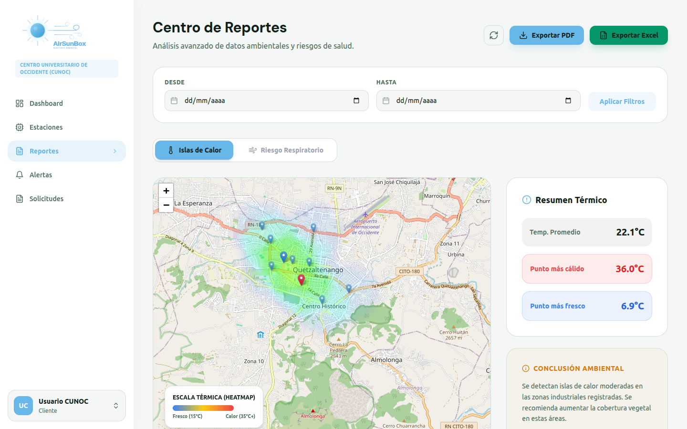

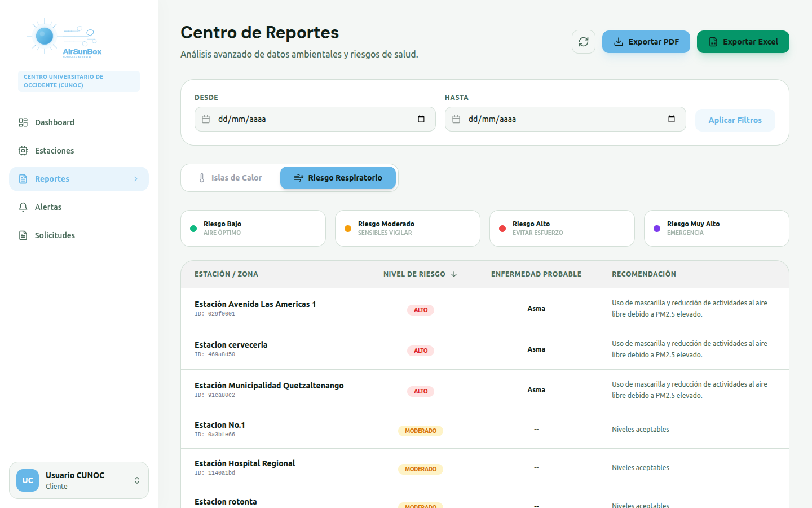

**Organizaciones independientes.** El reporte se arma por **espacio**, con
las variables y los niveles que definiste para ese espacio:

1. Elegí el espacio, la **estación** (o **Todas**) y el periodo: 7, 30 o 90
   días, o un rango personalizado.
2. El reporte muestra el resumen (estaciones, lecturas, cobertura de datos y
   última lectura) y, por cada variable: el promedio con su nivel, el mínimo,
   el máximo y cuándo se registró, la gráfica diaria con el rango entre mínimo
   y máximo, las **horas en cada nivel** y el **promedio por hora del día**.
   Al final están el estado de cada estación, las alertas y las incidencias
   del periodo.
3. **Exportar PDF** y **Exportar Excel** descargan el reporte completo.

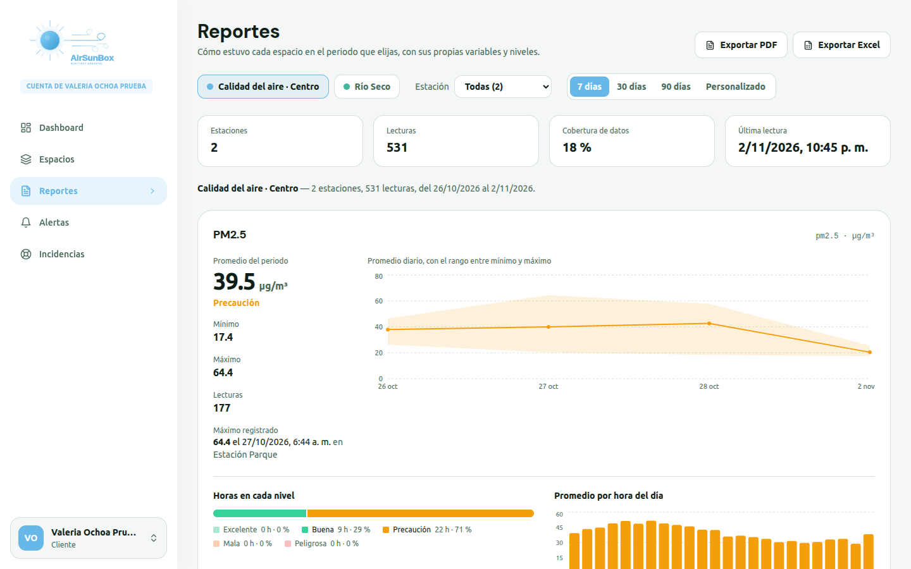

## 2.7 Solicitudes de estaciones (organizaciones dependientes)

Las organizaciones dependientes piden sus estaciones al equipo AirSunBox. Las
independientes no tienen esta opción, porque crean sus estaciones ellas mismas
(sección 2.8).

1. En **Solicitudes**, presioná **Nueva solicitud**.
2. Completá la **estación que necesitás**, la **ubicación de instalación** y la
   **cantidad** (de 1 a 50). Si querés, agregá una nota.
3. Presioná **Enviar solicitud**. La plataforma confirma el envío y la
   solicitud aparece en la lista como **Pendiente**.
4. Seguí el estado de cada pedido en la misma pantalla:
    - **Pendiente:** el equipo todavía no la revisó.
    - **En revisión:** el equipo la está evaluando.
    - **Aprobada:** el equipo te contactará para la instalación.
    - **Rechazada:** escribinos si querés más detalles.

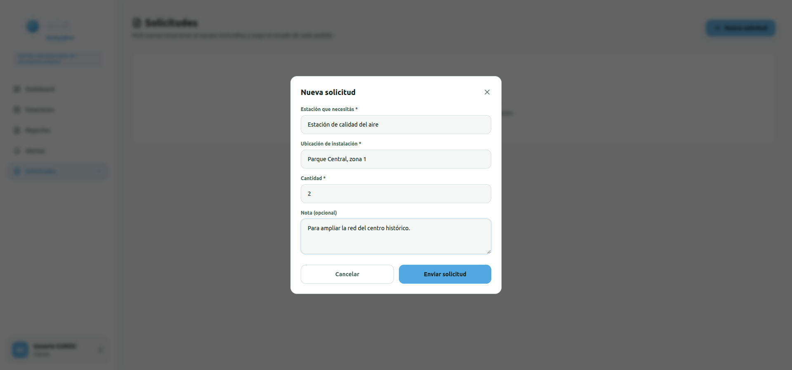

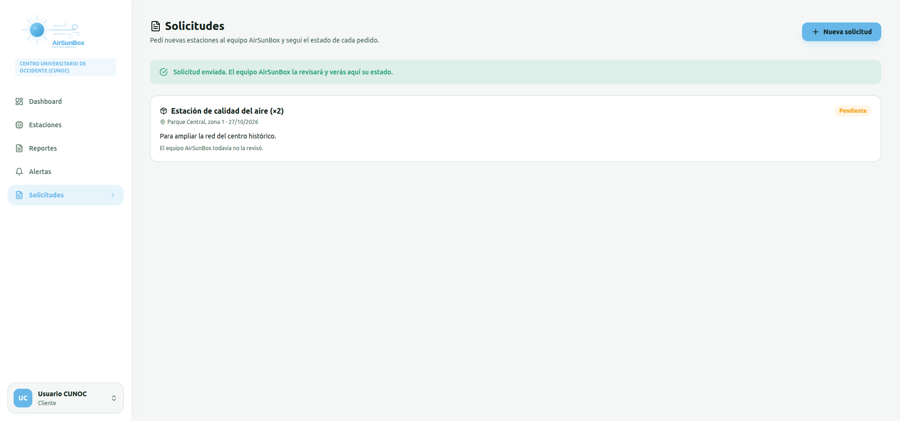

## 2.8 Espacios (organizaciones independientes)

Un **espacio** agrupa estaciones de un mismo lugar o tema (por ejemplo, «Calidad
del aire · Centro»), con su propio índice de calidad.

### Crear un espacio

1. En **Espacios**, presioná **Nuevo espacio**.
2. Escribí el **nombre** (obligatorio), elegí el **tipo de monitoreo** (aire,
   agua, suelo, ruido u otro), un **color** y, si querés, una descripción.
3. Presioná **Crear**.

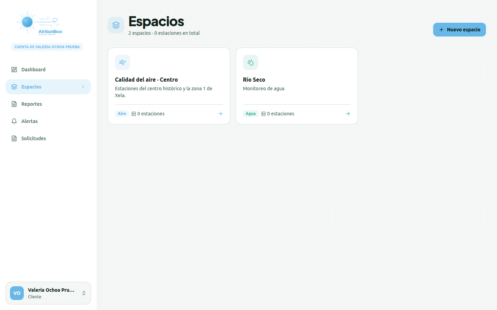

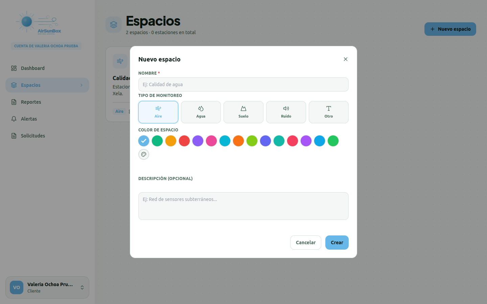

### Panel del espacio

El panel muestra cuántas estaciones tiene el espacio, cuántas están en línea y
cómo está configurado su índice de calidad. Desde ahí se agregan estaciones
(**Nueva estación**) y se configura el índice (**Configurar índice**). El lápiz
junto al nombre edita el espacio (nombre, tipo, ícono y color), y el menú **⋯**
permite eliminarlo.

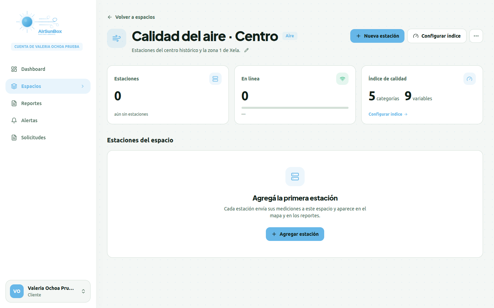

### Agregar una estación

1. En el panel del espacio, presioná **Nueva estación**.
2. Escribí el **nombre**, marcá la **ubicación** en el mapa (o usá **Usar mi
   ubicación**) y elegí las **variables a medir** del espacio.
3. Presioná **Crear**. La estación queda **Pendiente** hasta que el equipo
   físico envíe su primera lectura con su token (sección 2.3).

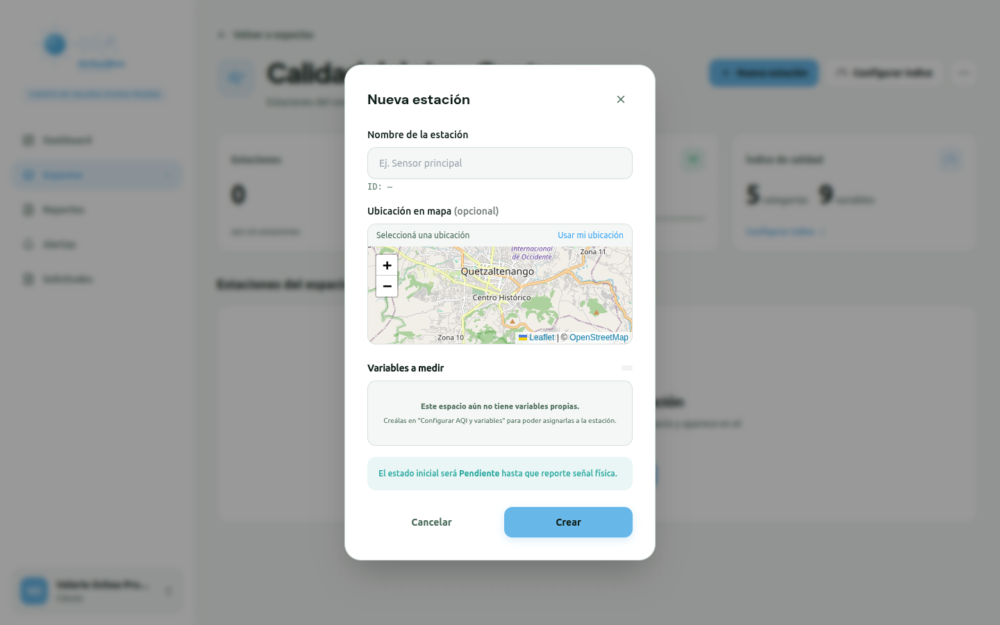

### Configurar el índice de calidad (AQI)

La configuración tiene tres pasos:

1. **Niveles:** cómo se califica el aire (por ejemplo Excelente, Buena,
   Precaución, Mala y Peligrosa), con su color y las **frases de
   recomendación** de cada nivel. El puntaje de 0 a 100 se reparte en partes
   iguales.
2. **Variables:** qué se mide y con qué prioridad. Cada variable muestra la
   **clave** que envía la estación.
3. **Límites:** dónde empieza cada nivel para cada variable.

A la derecha, **Así se verá el índice** se actualiza mientras editás, y
**Estado de la configuración** indica qué pasos están completos. Al guardar,
el índice de las estaciones del espacio se recalcula.

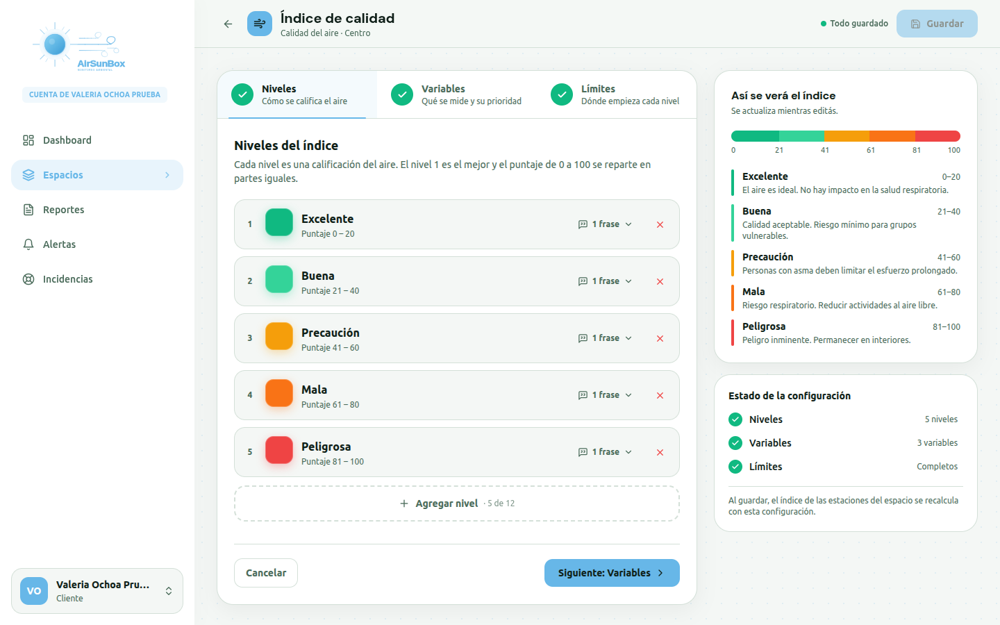

## 2.9 Incidencias

Si una estación falla o algo de la plataforma no funciona, avisale al equipo
AirSunBox desde **Incidencias**. También sirve para escribirle a soporte por
cualquier otro problema.

1. Presioná **Reportar incidencia**.
2. En **Estación afectada**, elegí la estación o dejá **Ninguna en particular**
   si es un problema general.
3. Describí qué está pasando (por ejemplo, desde cuándo dejó de enviar datos).
4. Presioná **Reportar incidencia**. La incidencia aparece en la lista como
   **Abierta** y el equipo recibe un aviso por correo.

Si elegiste una estación, queda **en revisión** hasta que se resuelva. En la
lista seguís cada incidencia:

- **Abierta:** el equipo todavía no la atendió.
- **En atención:** el equipo está trabajando en ella.
- **Resuelta:** se muestra la **respuesta del equipo** con lo que se hizo.

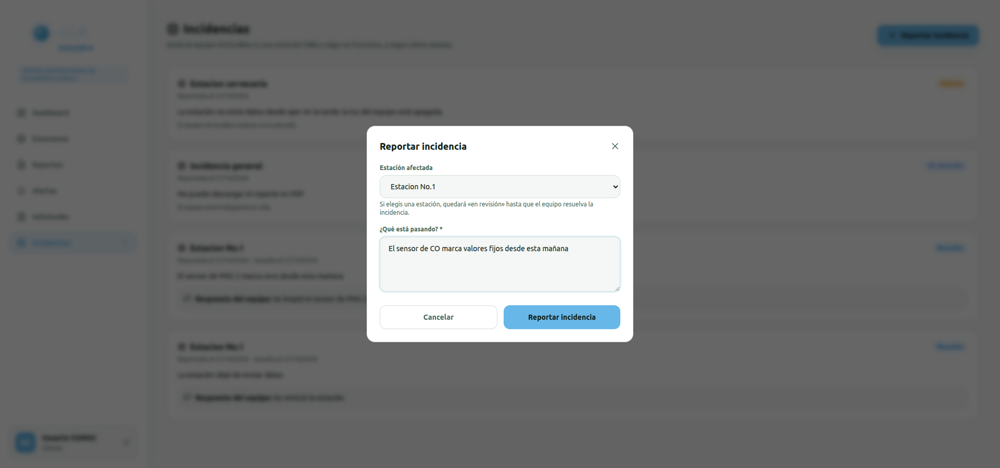

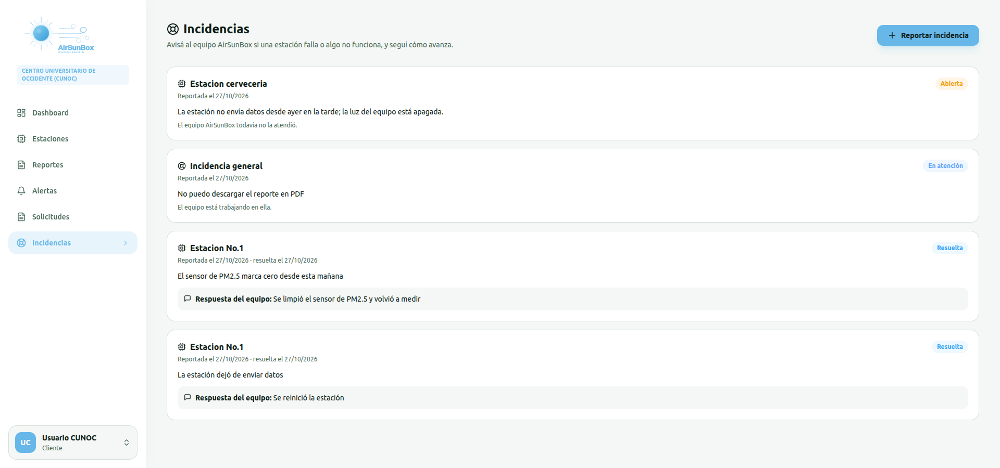

# Parte 3. Guía del administrador (equipo AirSunBox)

## 3.1 Roles del equipo

| Rol | Puede |
|---|---|
| **Superadministrador** | Todo, incluida la gestión del equipo y de otros administradores |
| **Administrador** | Clientes, estaciones, catálogo de variables, solicitudes, incidencias y trabajadores |
| **Trabajador** | Panel de control, solicitudes e incidencias |

## 3.2 Panel de control

El panel resume el estado de la plataforma con datos reales:

- **Tarjetas:** clientes, estaciones activas, estaciones sin conexión y
  solicitudes pendientes.
- **Solicitudes recientes:** las últimas con su estado. Un clic lleva a
  Solicitudes.
- **Incidencias pendientes:** las abiertas o en atención, con el cliente, la
  estación y el problema. Un clic lleva a Incidencias.
- **Próximos cobros:** clientes cuya suscripción vence en los próximos 30
  días.

Además, cada vez que un cliente envía una solicitud o reporta una incidencia,
el equipo recibe un **aviso por correo** con el detalle y un enlace a la
pantalla correspondiente.

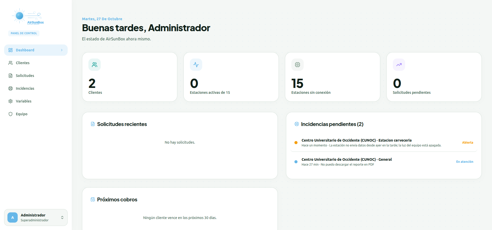

## 3.3 Clientes

- **Lista:** filtrá por **Todas**, **Dependientes** o **Independientes**, o
  buscá por nombre. Cada fila muestra el plan, las estaciones (en línea /
  total), la categoría, el estado y el vencimiento de la suscripción. En las
  organizaciones independientes se puede cambiar la categoría y marcarlas
  como **Exento** de pago.
- **Registrar cliente:** completá los datos de la organización y su tipo
  (dependiente o independiente). La plataforma crea la cuenta y genera las
  credenciales de acceso.

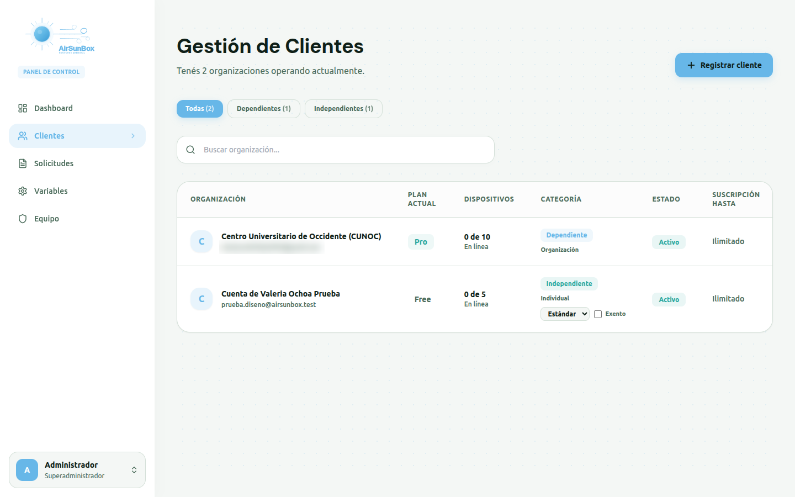

En el detalle de un cliente:

- **Editar datos** y **Suspender cliente** (o reactivarlo).
- **Enlazar estación:** crea una estación para el cliente y genera su token.
- **Datos de la cuenta:** contacto, correo de notificación, NIT, teléfono y
  notas internas.
- **Credenciales de acceso:** están protegidas. Para verlas se pide la
  contraseña del administrador. También se puede **restablecer la
  contraseña** del cliente, lo que cierra sus sesiones abiertas.
- Pestañas **Estaciones enlazadas** e **Historial de pagos**.

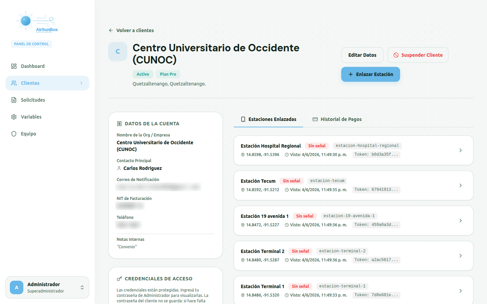

## 3.4 Catálogo de variables

El catálogo maestro define las variables que pueden medir las estaciones:
nombre, identificador, unidad, tipo de dato y sensor. Con **Nueva variable** se
agrega una variable al catálogo; con el ícono de papelera de cada tarjeta se elimina, previa confirmación.

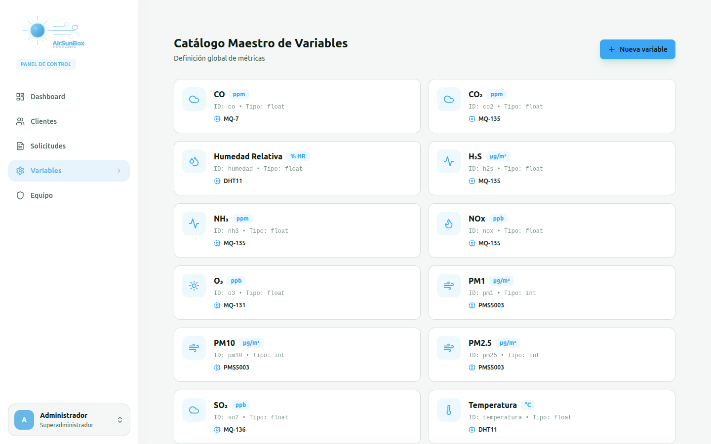

## 3.5 Solicitudes

Las solicitudes de nuevas estaciones llegan a esta pantalla con la
organización, el dispositivo, la cantidad, la ubicación, una nota y, si lo
hay, el comprobante de pago. Para cada una:

- **Aprobar** o **Rechazar**.
- **En revisión:** para marcar que se está evaluando.

El cambio de estado queda guardado de inmediato. Si no hay solicitudes, la
pantalla lo indica.

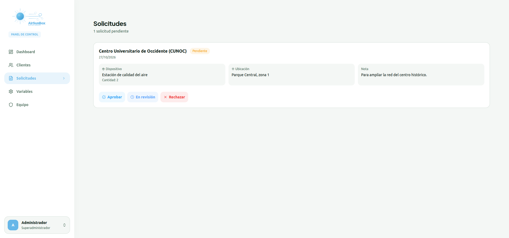

## 3.6 Incidencias

Acá llegan las incidencias que reportan los clientes, con la organización, la
estación (o **General** si no es de una estación) y el problema descrito. Los
filtros **Pendientes**, **Resueltas** y **Todas** ordenan la lista.

1. **Atender:** marca la incidencia como **en atención**, para que el cliente
   sepa que alguien la está trabajando.
2. **Resolver:** escribí qué se hizo (el cliente verá esta respuesta) y
   presioná **Marcar como resuelta**. Si la incidencia era de una estación,
   la estación vuelve a quedar activa.

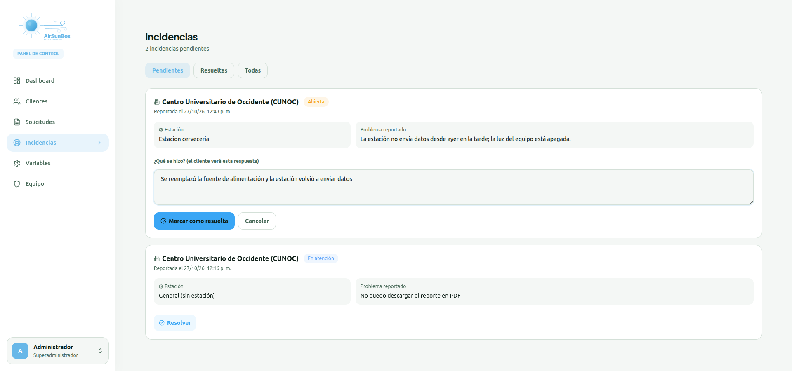

## 3.7 Equipo (solo superadministrador)

1. **Nuevo miembro:** nombre (opcional), correo, contraseña inicial (mínimo 8
   caracteres) y rol: trabajador, administrador o superadministrador. Solo un
   superadministrador puede crear administradores y otros
   superadministradores.
2. En cada miembro:
    - el selector junto a la **corona** cambia su rol (dar el rol de
      superadministrador pide confirmación, porque da control total);
    - el ícono de **bloqueo** suspende o reactiva la cuenta.

Nadie puede cambiar su propio rol o estado.

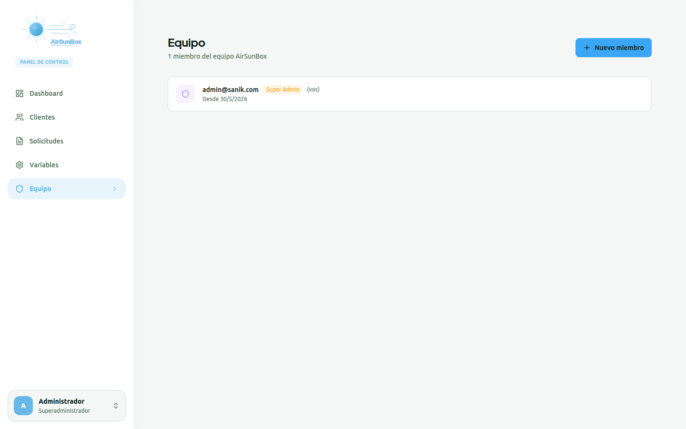

# Parte 4. Consulta pública (ciudadanos)

## 4.1 Mapa ambiental público

Sin crear cuenta, cualquier persona puede consultar la calidad del aire:

1. Abrí **Mapa en vivo** desde la página de inicio.
2. En el mapa, cada estación con datos recientes aparece como un **halo de
   color** según su calidad del aire: verde cuando es buena, y naranja o rojo
   cuando empeora. Así se ve de un vistazo qué parte de la ciudad está peor.
3. Elegí una zona con el botón **Zonas**, buscá una dirección o presioná
   **Quiero ver la calidad de aire donde yo estoy** para usar tu ubicación.
   **Ver todas** vuelve a la vista de toda la ciudad.
4. El panel de la zona muestra:
    - cuántas de sus estaciones están activas;
    - el **índice de calidad del aire** de la zona con su categoría (por
      ejemplo, 63 · Mala);
    - la temperatura, la humedad, el CO₂ y el CO;
    - el índice de cada estación de la zona;
    - una **recomendación** para la población según el nivel de riesgo.

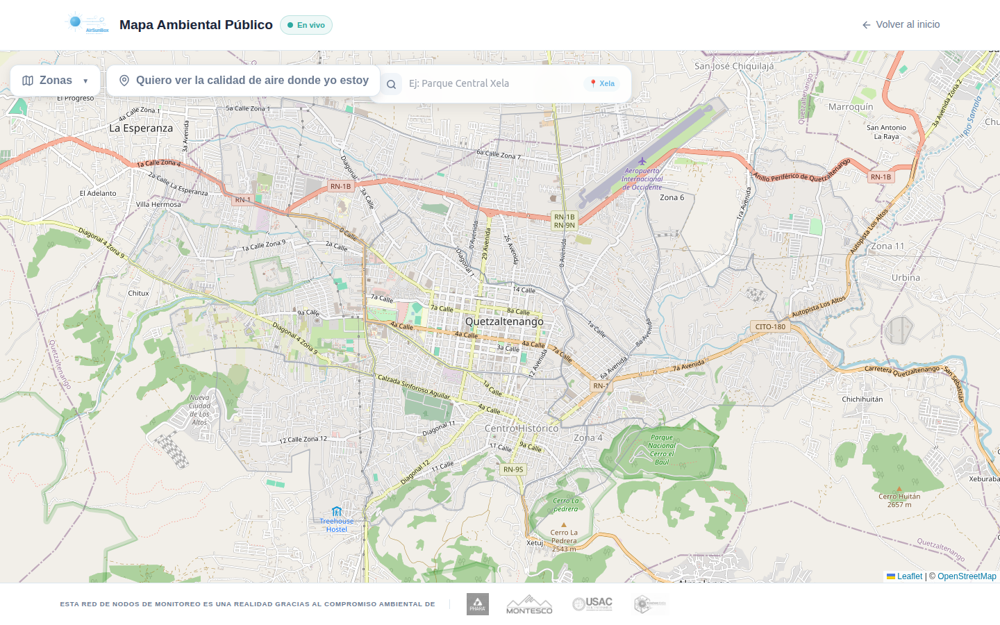

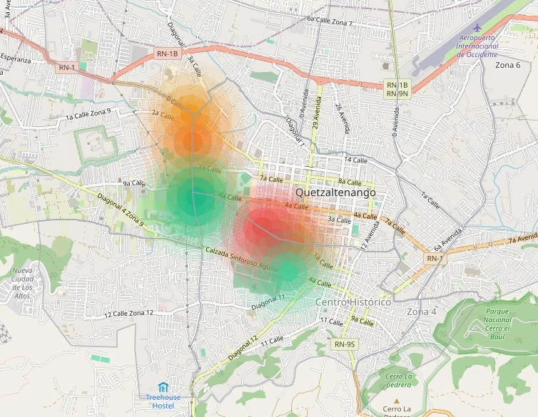

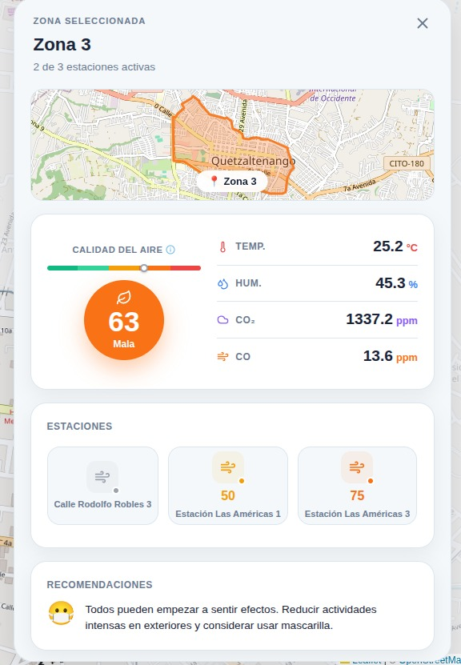

# Anexo. Permisos por rol

| Función | Ciudadano | Usuario (cliente) | Trabajador | Administrador | Superadmin |
|---|---|---|---|---|---|
| Mapa ambiental público | Sí | Sí | Sí | Sí | Sí |
| Perfil (editar nombre y teléfono), 2FA y contraseña | — | Sí | Sí | Sí | Sí |
| Panel, estaciones y gráficas de su organización | — | Sí | — | — | — |
| Alertas y reportes de su organización | — | Sí | — | — | — |
| Espacios e índice de calidad propios | — | Solo independientes | — | — | — |
| Solicitar estaciones | — | Solo dependientes | — | — | — |
| Reportar incidencias | — | Sí | — | — | — |
| Panel de control, solicitudes e incidencias | — | — | Sí | Sí | Sí |
| Clientes y catálogo de variables | — | — | — | Sí | Sí |
| Equipo interno | — | — | — | — | Sí |
